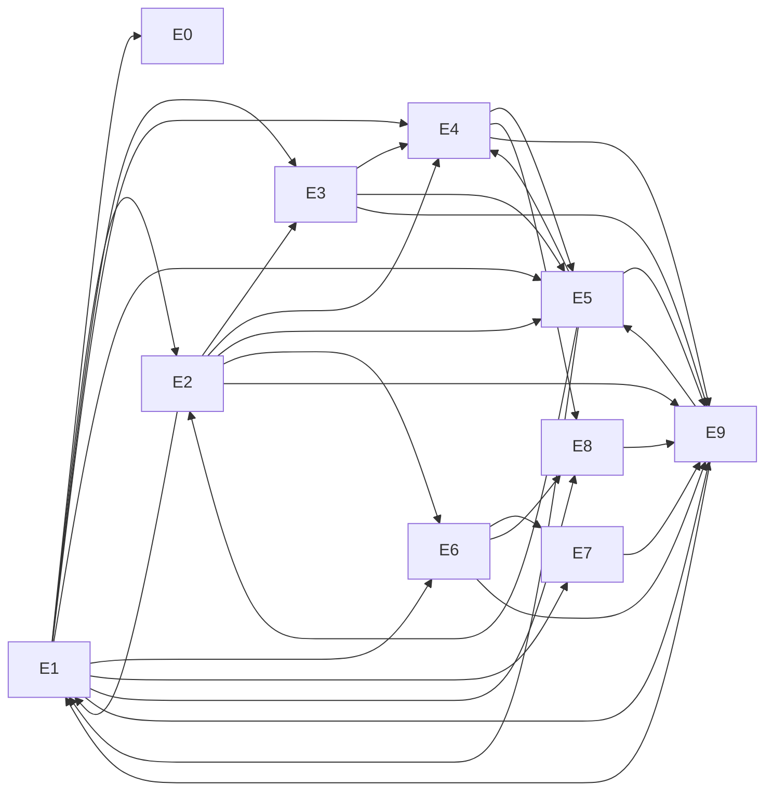

# Roadmap

> **Generated** from the issue drafts that created the GitHub issues. Regenerate it instead of hand-editing. The source of truth for status is [GitHub Issues](https://github.com/marinoscar/local-ai/issues). Each item key (e.g. `AGENT-05`) appears at the bottom of its issue and is the id used in spec §10 breakdowns.

**10 epics, 170 work items.** Phases: **0** foundation → **1** node agent and ark (works fully offline) → **2** cloud and gateway → **3** desktop.

## How to pick the next issue
1. Take the lowest **wave** whose items have all their dependencies merged.
2. Within a wave, prefer `doomsday-critical` items.
3. Each issue is self-contained. Read it, its linked spec sections and [AGENTS.md](../AGENTS.md).

## Epics
| Epic | Title | Items | Doomsday-critical |
|---|---|---|---|
| `E0` | Foundation: repo, tracking, docs guardrails | 6 | 1 |
| `E1` | Node agent (aiagent) & CLI (aictl) | 30 | 24 |
| `E2` | Models & llama.cpp router (swap models, migrate nodes) | 18 | 14 |
| `E3` | Ark sync & content (models, library, maps, kit) + AI-ARK drive | 15 | 15 |
| `E4` | Companion services & Survival Portal (library, speech, maps, vision) | 25 | 25 |
| `E5` | Installer & rebuild kit (online + fully offline install) | 14 | 13 |
| `E6` | Cloud control app at ai.marin.cr (EnterpriseAppBase) | 21 | 0 |
| `E7` | Unified OpenAI-compatible gateway at ai.marin.cr/v1 | 12 | 0 |
| `E8` | ai-desktop app (Electron shell, connected + offline) | 12 | 7 |
| `E9` | Drills, QA & runbook verification | 17 | 10 |

## Epic dependency graph

## Waves (topological order)
A wave is the length of the longest dependency chain ending at an item. All items in wave *n* can be worked in parallel once waves < *n* are merged.

**Wave 1:** `AGENT-01` ⚠, `CLOUD-01`, `DSK-01`, `FND-01`, `FND-02`, `FND-03`, `FND-06`, `OPS-01`, `OPS-05`

**Wave 2:** `AGENT-02` ⚠, `AGENT-03` ⚠, `AGENT-04`, `CAT-01` ⚠, `CLOUD-02`, `CLOUD-03`, `CLOUD-04`, `DSK-02` ⚠, `FND-04`, `INST-01` ⚠, `KIT-02` ⚠

**Wave 3:** `AGENT-05` ⚠, `CAT-04`, `CLOUD-05`, `FND-05` ⚠, `GW-01`

**Wave 4:** `AGENT-06` ⚠, `AGENT-07`, `AGENT-08` ⚠, `AGENT-09` ⚠, `AGENT-10` ⚠, `AICTL-01` ⚠, `CLOUD-06`, `CLOUD-07`, `CLOUD-08`, `CLOUD-10`, `GW-02`, `GW-03`

**Wave 5:** `AGENT-11` ⚠, `AGENT-12` ⚠, `AGENT-16` ⚠, `AICTL-02` ⚠, `AICTL-03` ⚠, `CLOUD-09`, `CLOUD-11`, `CLOUD-17`, `DSK-03` ⚠, `GW-04`, `ROUTER-01` ⚠, `ROUTER-02` ⚠, `SVC-02` ⚠

**Wave 6:** `AGENT-13` ⚠, `AICTL-04` ⚠, `AICTL-06` ⚠, `AICTL-07` ⚠, `AICTL-08` ⚠, `CAT-05`, `CLOUD-12`, `CLOUD-13`, `CLOUD-14`, `CLOUD-15`, `CLOUD-16`, `CLOUD-18`, `DRILL-01` ⚠, `DSK-04`, `DSK-05` ⚠, `DSK-06` ⚠, `GW-05`, `GW-06`, `INST-03` ⚠, `PORTAL-02` ⚠, `RB-07` ⚠, `ROUTER-03` ⚠, `SVC-01` ⚠, `SYNC-01` ⚠

**Wave 7:** `AGENT-14` ⚠, `CLOUD-19`, `DSK-07` ⚠, `DSK-10`, `GW-07`, `GW-08`, `GW-09`, `GW-10`, `INST-02` ⚠, `PORTAL-12` ⚠, `RB-09`, `ROUTER-04` ⚠, `ROUTER-05` ⚠, `SVC-13` ⚠, `SYNC-02` ⚠, `SYNC-04` ⚠

**Wave 8:** `AGENT-17`, `DRILL-03` ⚠, `DSK-11`, `GW-12`, `PORTAL-03` ⚠, `RB-03`, `ROUTER-06` ⚠, `ROUTER-07` ⚠, `ROUTER-10`, `SVC-03` ⚠, `SVC-08` ⚠, `SVC-09` ⚠, `SYNC-03` ⚠, `SYNC-05` ⚠, `SYNC-06` ⚠

**Wave 9:** `AGENT-15`, `AGENT-20` ⚠, `AICTL-05` ⚠, `CAT-02` ⚠, `DRILL-06` ⚠, `GW-11`, `KIT-01` ⚠, `ROUTER-08` ⚠, `SVC-04` ⚠, `SYNC-07` ⚠, `SYNC-09` ⚠, `SYNC-10` ⚠, `SYNC-11` ⚠, `SYNC-12` ⚠

**Wave 10:** `AGENT-18`, `CAT-03` ⚠, `DSK-08`, `KIT-04` ⚠, `KIT-06` ⚠, `PORTAL-01` ⚠, `RB-02`, `RB-10`, `ROUTER-09` ⚠, `SYNC-08` ⚠

**Wave 11:** `AGENT-19`, `CLOUD-20`, `INST-04` ⚠, `KIT-03` ⚠, `PORTAL-04` ⚠, `RB-06` ⚠, `SVC-05` ⚠, `SYNC-13` ⚠, `SYNC-14` ⚠

**Wave 12:** `AICTL-09` ⚠, `DSK-09` ⚠, `INST-05` ⚠, `KIT-05` ⚠, `PORTAL-05` ⚠, `PORTAL-06` ⚠, `PORTAL-09` ⚠, `RB-00`, `RB-04` ⚠, `RB-08`, `SVC-06` ⚠

**Wave 13:** `AICTL-10` ⚠, `DRILL-02` ⚠, `DRILL-05` ⚠, `DSK-12` ⚠, `INST-06` ⚠, `OPS-02` ⚠, `PORTAL-10` ⚠, `PORTAL-11` ⚠, `RB-01` ⚠, `SVC-07` ⚠, `SVC-10` ⚠

**Wave 14:** `INST-07`, `OPS-03` ⚠, `PORTAL-07` ⚠, `SVC-11` ⚠, `SVC-12` ⚠

**Wave 15:** `DRILL-04` ⚠, `INST-08` ⚠, `OPS-04` ⚠, `PORTAL-08` ⚠, `RB-05`

⚠ = doomsday-critical

## All items by epic

### `E0` Foundation: repo, tracking, docs guardrails
| Item | Title | Depends on | Labels |
|---|---|---|---|
| `FND-01` `FND-01` | CI guardrails - redaction check, gitleaks, pre-commit hook installer | — | `area:ci` `area:security` `size:S` |
| `FND-02` `FND-02` | CI - markdown link checker for docs (offline, relative links + anchors) | — | `area:ci` `size:S` |
| `FND-03` `FND-03` | CI - doctor code registry check (scripts/check-doctor-codes.sh) | — | `area:ci` `size:S` |
| `FND-04` `FND-04` | CI - Go pipeline for agent/ (vet, test, vendor check, static builds) | `AGENT-01` | `area:ci` `area:agent` `size:S` |
| `FND-05` `FND-05` | Release signing - minisign key, SHA256SUMS signing, release workflows skeleton | `FND-04` | `area:ci` `area:security` `size:M` `doomsday-critical` |
| `FND-06` `FND-06` | Owner task - create inventory.local.yaml on owner machines and the ark drive | — | `area:security` `size:S` `needs-hardware` |

### `E1` Node agent (aiagent) & CLI (aictl)
| Item | Title | Depends on | Labels |
|---|---|---|---|
| `AGENT-01` `AGENT-01` | Agent skeleton - multi-call binary, app wiring, static builds, vendoring | — | `area:agent` `area:ci` `size:M` `doomsday-critical` |
| `AGENT-02` `AGENT-02` | Agent config store - node.yaml schema, validation, atomic writer, hot reload | `AGENT-01` | `area:agent` `size:M` `doomsday-critical` |
| `AGENT-03` `AGENT-03` | Agent state store - state.json single writer, atomic, .bak, corruption fallback | `AGENT-01` | `area:agent` `size:S` `doomsday-critical` |
| `AGENT-04` `AGENT-04` | Agent logging - slog JSON handler, secret scrubber, append-only audit log | `AGENT-01` | `area:agent` `area:security` `size:M` |
| `AGENT-05` `AGENT-05` | Agent HTTP server - listeners, middleware, Host/Origin/CSRF, error envelope | `AGENT-01`, `AGENT-02`, `AGENT-04` | `area:agent` `area:security` `size:M` `doomsday-critical` |
| `AGENT-06` `AGENT-06` | Agent auth - tokens, sessions, UI codes, PIN, peer creds, grants | `AGENT-01`, `AGENT-05` | `area:agent` `area:security` `size:L` `doomsday-critical` |
| `AGENT-07` `AGENT-07` | Agent OpenAPI - openapi.yaml for all routes, conformance and bijection tests | `AGENT-01`, `AGENT-05` | `area:agent` `area:ci` `size:L` |
| `AGENT-08` `AGENT-08` | Agent event bus and SSE endpoint - ring buffer, replay, resync, filters | `AGENT-01`, `AGENT-05` | `area:agent` `size:M` `doomsday-critical` |
| `AGENT-09` `AGENT-09` | Agent systemd manager - D-Bus and systemctl fallback, /services, /logs | `AGENT-01`, `AGENT-05` | `area:agent` `size:M` `doomsday-critical` `needs-hardware` |
| `AGENT-10` `AGENT-10` | Agent hardware sampler - GPU (NVIDIA/AMD), RAM, disk, battery, thermal, OOM | `AGENT-01`, `AGENT-05` | `area:agent` `size:L` `doomsday-critical` `needs-hardware` |
| `AGENT-11` `AGENT-11` | Agent doctor - check registry, codes.go en/es, alerts, /doctor, CI code check | `AGENT-08` | `area:agent` `area:ci` `size:M` `doomsday-critical` |
| `AGENT-12` `AGENT-12` | Agent mode engine - resumable transitions, preemption, /mode, /mode/survival | `AGENT-03`, `AGENT-06`, `AGENT-08`, `AGENT-09` | `area:agent` `size:L` `doomsday-critical` `needs-hardware` |
| `AGENT-13` `AGENT-13` | Agent Tailscale Serve manager and connectivity prober | `AGENT-12` | `area:agent` `area:security` `size:M` `doomsday-critical` `needs-hardware` |
| `AGENT-14` `AGENT-14` | Agent routes - /status, /portal/status, /profile, /catalog | `AGENT-07`, `AGENT-10`, `AGENT-12`, `CAT-01`, `CAT-05`, `ROUTER-03` | `area:agent` `size:M` `doomsday-critical` |
| `AGENT-15` `AGENT-15` | Agent routes - /models views, download, delete, /key and /key/rotate | `AGENT-14`, `ROUTER-03`, `ROUTER-04`, `ROUTER-05`, `ROUTER-06` | `area:agent` `area:security` `size:M` |
| `AGENT-16` `AGENT-16` | Agent proxy and static-path plumbing - reverse-proxy helper, /docs/, path safety, CSP | `AGENT-05`, `AGENT-06` | `area:agent` `area:security` `size:M` `doomsday-critical` `needs-hardware` |
| `AGENT-17` `AGENT-17` | Agent cloud link - register, heartbeat, state snapshot, key push, /cloud routes | `AGENT-12`, `AGENT-14` | `area:agent` `area:security` `size:L` `needs-hardware` |
| `AGENT-18` `AGENT-18` | Agent cloud link - claim loop, strict job decoders, executors, lease and settle | `AGENT-15`, `AGENT-17` | `area:agent` `area:security` `size:L` `needs-hardware` |
| `AGENT-19` `AGENT-19` | Agent self-update - signed release, minisign + sha256, health-checked rollback | `AGENT-09`, `AGENT-17`, `AGENT-18` | `area:agent` `area:security` `size:L` `needs-hardware` |
| `AGENT-20` `AGENT-20` | Agent startup sequence, graceful shutdown, sd_notify and localai-agent.service | `AGENT-11`, `AGENT-12`, `AGENT-13`, `AGENT-17` | `area:agent` `size:M` `doomsday-critical` `needs-hardware` |
| `AICTL-01` `AICTL-01` | aictl - CLI framework, socket/TCP transport, exit-code map | `AGENT-01`, `AGENT-05` | `area:cli` `size:M` `doomsday-critical` |
| `AICTL-02` `AICTL-02` | aictl - output layer, --json writer, confirmations and PIN flow | `AICTL-01` | `area:cli` `size:M` `doomsday-critical` |
| `AICTL-03` `AICTL-03` | aictl - progress display from SSE events, Ctrl-C and resync handling | `AICTL-01`, `AGENT-08` | `area:cli` `size:M` `doomsday-critical` |
| `AICTL-04` `AICTL-04` | aictl - read-only commands (status, models, services, logs, doctor, version) | `AICTL-02` | `area:cli` `size:L` `doomsday-critical` `needs-hardware` |
| `AICTL-05` `AICTL-05` | aictl - model and service commands (load, unload, default, delete, bench) | `AICTL-03`, `ROUTER-05`, `ROUTER-10` | `area:cli` `size:M` `doomsday-critical` `needs-hardware` |
| `AICTL-06` `AICTL-06` | aictl - key, mode, ark, catalog, profile, cloud, ui-code and drill commands | `AICTL-03` | `area:cli` `size:L` `doomsday-critical` `needs-hardware` |
| `AICTL-07` `AICTL-07` | aictl - local root commands (pin, token, catalog restore/use, backup-config) | `AICTL-02`, `AGENT-02`, `AGENT-04`, `AGENT-06`, `CAT-01` | `area:cli` `area:security` `size:L` `doomsday-critical` |
| `AICTL-08` `AICTL-08` | aictl - docs render (offline HTML/PDF runbooks and survival card) | `AICTL-02` | `area:cli` `area:runbook` `size:M` `doomsday-critical` |
| `AICTL-09` `AICTL-09` | aictl - rebuild-llama and update commands | `AICTL-06`, `ROUTER-08`, `KIT-04`, `AGENT-19` | `area:cli` `size:M` `doomsday-critical` `needs-hardware` |
| `AICTL-10` `AICTL-10` | aictl - surface completion (verify-release, services, drill, kit, help) | `AICTL-04`, `AICTL-06`, `AGENT-19`, `KIT-03`, `KIT-05`, `KIT-06`, `DRILL-06` | `area:cli` `size:M` `doomsday-critical` `needs-hardware` |

### `E2` Models & llama.cpp router (swap models, migrate nodes)
| Item | Title | Depends on | Labels |
|---|---|---|---|
| `CAT-01` `CAT-01` | Catalog - schema structs, strict loader, lint rules and aictl catalog lint | `AGENT-01` | `area:catalog` `area:cli` `area:ci` `size:L` `doomsday-critical` |
| `CAT-02` `CAT-02` | Catalog - populate initial models.yaml with pinned revisions and measured VRAM | `CAT-01`, `ROUTER-10` | `area:catalog` `size:M` `needs-hardware` `doomsday-critical` |
| `CAT-04` `CAT-04` | Catalog - release tagging workflow and stable channel resolution | `CAT-01` | `area:catalog` `area:ci` `size:S` |
| `CAT-05` `CAT-05` | Catalog - profile match and suggest, effective plan, loadable with reasons | `CAT-01`, `AGENT-10`, `ROUTER-02` | `area:catalog` `area:cli` `size:M` |
| `OPS-01` `OPS-01` | Ops - capture pre-migration facts on ai-n1, ai-n2, ai-n3 (units, flags, VRAM, builds) | — | `area:router` `size:S` `needs-hardware` |
| `OPS-02` `OPS-02` | Ops - migrate ai-n3 from llama-qwen.service to the agent-managed router | `OPS-01`, `ROUTER-09`, `AGENT-20`, `INST-05` | `area:router` `size:M` `needs-hardware` `doomsday-critical` |
| `OPS-03` `OPS-03` | Ops - migrate ai-n2 from llama-qwen.service to the agent-managed router | `OPS-02` | `area:router` `size:M` `needs-hardware` `doomsday-critical` |
| `OPS-04` `OPS-04` | Ops - migrate ai-n1 from llama-qwen.service to the agent-managed router | `OPS-03` | `area:router` `size:M` `needs-hardware` `doomsday-critical` |
| `ROUTER-01` `ROUTER-01` | Router - typed llama-server router client and status watcher | `AGENT-01`, `AGENT-08`, `AGENT-09` | `area:router` `size:M` `doomsday-critical` |
| `ROUTER-02` `ROUTER-02` | Router - static and dynamic fit rules, eviction planner, loadable_reason | `AGENT-01`, `AGENT-10` | `area:router` `size:M` `doomsday-critical` |
| `ROUTER-03` `ROUTER-03` | Router - models.ini preset generator, env merge and reload-safety rule | `ROUTER-01`, `ROUTER-02`, `CAT-01` | `area:router` `size:L` `doomsday-critical` `needs-hardware` |
| `ROUTER-04` `ROUTER-04` | Router - localai-llama unit generator (router + single), env drop-in, cache dir | `ROUTER-03`, `AGENT-09` | `area:router` `size:M` `doomsday-critical` `needs-hardware` |
| `ROUTER-05` `ROUTER-05` | Router - load/unload orchestrator with eviction, rollback and modelOpsMu | `ROUTER-01`, `ROUTER-02`, `ROUTER-03`, `AGENT-03`, `AGENT-05`, `AGENT-07` | `area:router` `size:L` `doomsday-critical` `needs-hardware` |
| `ROUTER-06` `ROUTER-06` | Router - boot reconcile, default model and restore after llama restart or key rotate | `ROUTER-05` | `area:router` `size:M` `doomsday-critical` `needs-hardware` |
| `ROUTER-07` `ROUTER-07` | Router - single-model fallback mode and router-single switching | `ROUTER-04`, `ROUTER-05` | `area:router` `size:M` `doomsday-critical` `needs-hardware` |
| `ROUTER-08` `ROUTER-08` | Router - llama.cpp build manager (cmake per backend, smoke, BUILD.json, switch) | `ROUTER-04`, `ROUTER-06` | `area:router` `size:L` `doomsday-critical` `needs-hardware` |
| `ROUTER-09` `ROUTER-09` | Router - legacy llama-qwen migration (M0-M10, rollback R1-R6) | `ROUTER-03`, `ROUTER-04`, `ROUTER-06`, `ROUTER-08`, `AGENT-02`, `AGENT-03` | `area:router` `size:L` `doomsday-critical` `needs-hardware` |
| `ROUTER-10` `ROUTER-10` | Router - bench helper measuring VRAM and throughput for catalog min_vram_mib | `ROUTER-05` | `area:router` `size:M` `needs-hardware` |

### `E3` Ark sync & content (models, library, maps, kit) + AI-ARK drive
| Item | Title | Depends on | Labels |
|---|---|---|---|
| `CAT-03` `CAT-03` | Catalog - populate initial ark content (Kiwix books, maps, places, docs, first aid) | `CAT-01`, `SYNC-05`, `SYNC-09`, `SYNC-10`, `SYNC-11` | `area:catalog` `size:M` `doomsday-critical` `needs-hardware` |
| `SYNC-01` `SYNC-01` | Ark sync - content roots, root ids and ROOT.json | `AGENT-01`, `AGENT-11` | `area:ark-sync` `size:S` `doomsday-critical` |
| `SYNC-02` `SYNC-02` | Ark sync - AI-ARK drive detection, classification and GET /ark/drives | `SYNC-01`, `AGENT-05`, `AGENT-08` | `area:ark-sync` `size:M` `doomsday-critical` `needs-hardware` |
| `SYNC-03` `SYNC-03` | Ark sync - safe eject, drive init, mount and set-profile routes | `SYNC-02`, `AGENT-06` | `area:ark-sync` `size:S` `doomsday-critical` `needs-hardware` |
| `SYNC-04` `SYNC-04` | Ark sync - MANIFEST.json, items.json journal and BestCopy index | `SYNC-01`, `CAT-01` | `area:ark-sync` `size:M` `doomsday-critical` |
| `SYNC-05` `SYNC-05` | Ark sync - pure planner, budget rules and dry-run output | `SYNC-04`, `CAT-01`, `AGENT-05` | `area:ark-sync` `size:L` `doomsday-critical` |
| `SYNC-06` `SYNC-06` | Ark sync - resumable downloader, streaming sha256, bandwidth limit, retries | `SYNC-04` | `area:ark-sync` `size:L` `doomsday-critical` |
| `SYNC-07` `SYNC-07` | Ark sync - item state machine, atomic swap, quarantine and run engine | `SYNC-05`, `SYNC-06`, `AGENT-08`, `AGENT-10`, `AGENT-12`, `AGENT-13`, `CAT-04` | `area:ark-sync` `size:L` `doomsday-critical` |
| `SYNC-08` `SYNC-08` | Ark sync - retention.CanDelete, trash purge, quarantine expiry and prune | `SYNC-07`, `AGENT-06` | `area:ark-sync` `size:S` `doomsday-critical` |
| `SYNC-09` `SYNC-09` | Ark sync - resolvers for huggingface, url and github_release | `SYNC-06` | `area:ark-sync` `size:M` `doomsday-critical` |
| `SYNC-10` `SYNC-10` | Ark sync - resolvers for kiwix ZIMs and pmtiles_extract maps | `SYNC-06` | `area:ark-sync` `size:M` `doomsday-critical` |
| `SYNC-11` `SYNC-11` | Ark sync - resolvers for git_mirror, apt_closure and repo_docs | `SYNC-06`, `AICTL-08` | `area:ark-sync` `size:L` `doomsday-critical` |
| `SYNC-12` `SYNC-12` | Ark sync - READY.json readiness report, colour rules and GET /ark | `SYNC-04`, `SYNC-05`, `AGENT-05` | `area:ark-sync` `size:S` `doomsday-critical` |
| `SYNC-13` `SYNC-13` | Ark sync - budgeted re-verification (bit rot) and offline import from a drive | `SYNC-07`, `SYNC-08`, `SYNC-12`, `AGENT-02` | `area:ark-sync` `size:M` `doomsday-critical` `needs-hardware` |
| `SYNC-14` `SYNC-14` | Ark sync - drive extras, sync timer units, scheduled exit codes and cloud report | `SYNC-07`, `SYNC-12`, `AGENT-17`, `AGENT-18` | `area:ark-sync` `size:M` `doomsday-critical` `needs-hardware` |

### `E4` Companion services & Survival Portal (library, speech, maps, vision)
| Item | Title | Depends on | Labels |
|---|---|---|---|
| `PORTAL-01` `PORTAL-01` | Portal - status endpoint and capability model (GET /api/v1/portal/status) | `AGENT-14`, `AGENT-11`, `SVC-01`, `SVC-13`, `SYNC-12` | `area:portal` `size:M` `doomsday-critical` |
| `PORTAL-02` `PORTAL-02` | Portal - Portal session cookie, scope allowlist, Origin check, rate limits | `AGENT-06`, `AGENT-12` | `area:portal` `area:security` `size:M` `doomsday-critical` |
| `PORTAL-03` `PORTAL-03` | Portal - /chat/ key-injecting proxy to the llama WebUI | `PORTAL-02`, `ROUTER-05`, `AGENT-16` | `area:portal` `area:security` `size:M` `doomsday-critical` `needs-hardware` |
| `PORTAL-04` `PORTAL-04` | Portal - SPA shell, home screen, i18n, accessibility base | `PORTAL-01`, `AGENT-16` | `area:portal` `size:L` `doomsday-critical` |
| `PORTAL-05` `PORTAL-05` | Portal - offline asset enforcement (CSP, build scan, Playwright offline test) | `PORTAL-04` | `area:portal` `area:ci` `size:S` `doomsday-critical` |
| `PORTAL-06` `PORTAL-06` | Portal - Status and battery screen, Switch brain screen | `PORTAL-01`, `PORTAL-02`, `PORTAL-04`, `AGENT-08` | `area:portal` `size:M` `doomsday-critical` `needs-hardware` |
| `PORTAL-07` `PORTAL-07` | Portal - Talk flow (record, browser WAV conversion, STT, streamed chat, TTS) | `PORTAL-02`, `PORTAL-03`, `PORTAL-04`, `SVC-07`, `SVC-08` | `area:portal` `size:L` `doomsday-critical` `needs-hardware` |
| `PORTAL-08` `PORTAL-08` | Portal - Ask about a photo flow (capture, resize, strip EXIF, vision answer) | `PORTAL-03`, `PORTAL-06`, `PORTAL-07` | `area:portal` `size:M` `doomsday-critical` `needs-hardware` |
| `PORTAL-09` `PORTAL-09` | Portal - Library screen (OpenSearch search, books list) and reader frame | `PORTAL-04`, `SVC-04` | `area:portal` `size:M` `doomsday-critical` |
| `PORTAL-10` `PORTAL-10` | Portal - Maps and Manuals screens, built-in emergency help page | `PORTAL-09`, `AGENT-16` | `area:portal` `size:S` `doomsday-critical` |
| `PORTAL-11` `PORTAL-11` | Portal - First-aid panel (portal_links resolution, availability, ES fallback) | `CAT-01`, `PORTAL-01`, `PORTAL-09`, `SVC-03` | `area:portal` `size:M` `doomsday-critical` |
| `PORTAL-12` `PORTAL-12` | Portal - printable one-page Survival card template (EN/ES) | `AICTL-08` | `area:portal` `area:runbook` `size:M` `doomsday-critical` |
| `SVC-01` `SVC-01` | Companion services - health supervisor, restart budget and GET /services | `AGENT-08`, `AGENT-09`, `AGENT-11` | `area:services` `size:M` `doomsday-critical` `needs-hardware` |
| `SVC-02` `SVC-02` | Companion services - kiwix-tools install from kit and localai-kiwix unit | `AGENT-01`, `AGENT-09` | `area:services` `size:S` `doomsday-critical` |
| `SVC-03` `SVC-03` | Companion services - merged and per-root Kiwix library regeneration | `SVC-01`, `SVC-02`, `SYNC-04` | `area:services` `size:M` `doomsday-critical` |
| `SVC-04` `SVC-04` | Companion services - /library/ reverse proxy, CSP and book map | `SVC-03`, `AGENT-16` | `area:services` `size:S` `doomsday-critical` |
| `SVC-05` `SVC-05` | Companion services - whisper.cpp builder per backend, rebuild-whisper, unit | `KIT-04`, `AGENT-09` | `area:services` `size:M` `doomsday-critical` `needs-hardware` |
| `SVC-06` `SVC-06` | Companion services - whisper model selection, GPU-or-CPU rule, whisper.env | `SVC-05`, `SYNC-04`, `AGENT-10`, `CAT-01` | `area:services` `size:S` `doomsday-critical` |
| `SVC-07` `SVC-07` | Companion services - POST /speech/stt (WAV decode, resample, queue, whisper client) | `SVC-06`, `AGENT-06` | `area:services` `size:M` `doomsday-critical` `needs-hardware` |
| `SVC-08` `SVC-08` | Companion services - Piper install, POST /speech/tts and GET /speech/voices | `SVC-01`, `SYNC-04`, `CAT-01`, `AGENT-06` | `area:services` `size:M` `doomsday-critical` |
| `SVC-09` `SVC-09` | Companion services - pmtiles Range serving, map assets and /maps/catalog.json | `SYNC-04`, `AGENT-16`, `SVC-01` | `area:services` `size:M` `doomsday-critical` |
| `SVC-10` `SVC-10` | Companion services - offline MapLibre map viewer with local style | `SVC-09`, `PORTAL-05` | `area:services` `size:L` `doomsday-critical` |
| `SVC-11` `SVC-11` | Companion services - offline place index, /maps/search and /maps/nearest | `SYNC-09`, `SVC-09`, `SVC-10` | `area:services` `size:M` `doomsday-critical` |
| `SVC-12` `SVC-12` | Companion services - Where am I (gpsd, NMEA serial, manual location) | `SVC-10`, `AGENT-03`, `AGENT-05` | `area:services` `size:M` `doomsday-critical` `needs-hardware` |
| `SVC-13` `SVC-13` | Companion services - vision wiring, photo model selection and LAI-SVC-040/041 | `ROUTER-02`, `ROUTER-03`, `AGENT-11` | `area:services` `size:S` `doomsday-critical` `needs-hardware` |

### `E5` Installer & rebuild kit (online + fully offline install)
| Item | Title | Depends on | Labels |
|---|---|---|---|
| `INST-01` `INST-01` | Installer - driver skeleton, logging, flags, dry-run framework | `AGENT-01` | `area:installer` `size:M` `doomsday-critical` |
| `INST-02` `INST-02` | Installer - preflight checks and agent/catalog staging | `INST-01`, `CAT-01`, `CAT-05`, `KIT-02` | `area:installer` `size:M` `doomsday-critical` |
| `INST-03` `INST-03` | Installer - laptop hardening (P4) and LAI-INS-040..044 checks | `INST-01`, `AGENT-11` | `area:installer` `size:M` `doomsday-critical` `needs-hardware` |
| `INST-04` `INST-04` | Installer - users, dirs, polkit rule, packages and companion binaries | `INST-01`, `INST-02`, `KIT-06` | `area:installer` `size:M` `doomsday-critical` |
| `INST-05` `INST-05` | Installer - llama.cpp build or reuse (P7) and migration hand-off (P8) | `INST-01`, `INST-04`, `KIT-04`, `ROUTER-09` | `area:installer` `size:M` `doomsday-critical` `needs-hardware` |
| `INST-06` `INST-06` | Installer - node.yaml, units, agent start, API key, admin PIN, enroll | `INST-01`, `INST-04`, `INST-05`, `AGENT-02`, `AGENT-20`, `AICTL-06`, `AICTL-07`, `ROUTER-04`, `SVC-02`, `SVC-05`, `SYNC-14`, `DRILL-01` | `area:installer` `size:M` `doomsday-critical` `needs-hardware` |
| `INST-07` `INST-07` | Installer - Tailscale, initial content, summary and VPS checklist | `INST-06`, `INST-03`, `AICTL-06`, `SYNC-05`, `SYNC-13` | `area:installer` `size:M` |
| `INST-08` `INST-08` | Installer - uninstall (incl. --restore-legacy) and --repair | `INST-03`, `INST-05`, `INST-06`, `INST-07` | `area:installer` `size:M` `doomsday-critical` |
| `KIT-01` `KIT-01` | Rebuild kit - kit items in ark.yaml, pins.json, kit README and MANIFEST | `CAT-01`, `SYNC-04`, `SYNC-05` | `area:rebuild-kit` `size:M` `doomsday-critical` |
| `KIT-02` `KIT-02` | Rebuild kit - node release CI (binaries, SHA256SUMS, minisign, source tarball) | `AGENT-01` | `area:rebuild-kit` `area:ci` `size:M` `doomsday-critical` |
| `KIT-03` `KIT-03` | Rebuild kit - kit verification, completeness and aictl kit status|verify | `KIT-01`, `KIT-04`, `SYNC-07`, `SYNC-12`, `AICTL-01` | `area:rebuild-kit` `size:M` `doomsday-critical` `needs-hardware` |
| `KIT-04` `KIT-04` | Rebuild kit - rebuild-llama offline source, kit preflight, unprivileged compile | `ROUTER-08`, `KIT-01`, `AICTL-01` | `area:rebuild-kit` `size:L` `doomsday-critical` `needs-hardware` |
| `KIT-05` `KIT-05` | Rebuild kit - rebuild-agent, rebuild-whisper kit paths, prebuilt export/restore | `KIT-04`, `KIT-02`, `AGENT-19`, `SVC-05` | `area:rebuild-kit` `size:M` `doomsday-critical` `needs-hardware` |
| `KIT-06` `KIT-06` | Rebuild kit - offline apt (kit install-debs) and kit install <tool> | `KIT-01`, `SYNC-11`, `AICTL-01`, `SVC-02`, `SVC-08` | `area:rebuild-kit` `size:M` `doomsday-critical` |

### `E6` Cloud control app at ai.marin.cr (EnterpriseAppBase)
| Item | Title | Depends on | Labels |
|---|---|---|---|
| `CLOUD-01` `CLOUD-01` | Cloud - scaffold apps/cloud from the EAB starter | — | `area:cloud` `size:M` |
| `CLOUD-02` `CLOUD-02` | Cloud - monorepo CI workflow, Renovate rule and aictl build step | `CLOUD-01`, `AGENT-01` | `area:cloud` `area:ci` `size:S` |
| `CLOUD-03` `CLOUD-03` | Cloud - identity, allowlist and Local AI permissions | `CLOUD-01` | `area:cloud` `area:security` `size:S` |
| `CLOUD-04` `CLOUD-04` | Cloud - Prisma fragments, partial indexes, ownership and node settings seed | `CLOUD-01` | `area:cloud` `size:M` |
| `CLOUD-05` `CLOUD-05` | Cloud - node binding guard and localai config handshake | `CLOUD-04` | `area:cloud` `area:security` `size:M` |
| `CLOUD-06` `CLOUD-06` | Cloud - state snapshot ingestion, scrubber and node model projection | `CLOUD-05` | `area:cloud` `size:L` |
| `CLOUD-07` `CLOUD-07` | Cloud - node llama keys in the EAB credential store | `CLOUD-05` | `area:cloud` `area:security` `size:M` |
| `CLOUD-08` `CLOUD-08` | Cloud - command plane node side - registry, claim long-poll, leases, sweeper | `CLOUD-05` | `area:cloud` `size:L` |
| `CLOUD-09` `CLOUD-09` | Cloud - command API for the UI with permissions, refusals and audit | `CLOUD-08`, `CLOUD-03` | `area:cloud` `size:M` |
| `CLOUD-10` `CLOUD-10` | Cloud - catalog import, lint, approve and serve to nodes | `CLOUD-02`, `CLOUD-04`, `CLOUD-05`, `CAT-01` | `area:cloud` `area:catalog` `size:L` |
| `CLOUD-11` `CLOUD-11` | Cloud web - Lab overview page, node cards and status chips | `CLOUD-03`, `CLOUD-06` | `area:cloud` `size:M` |
| `CLOUD-12` `CLOUD-12` | Cloud web - Node detail page with Models, Ark, Services, Logs, Keys, Settings tabs | `CLOUD-09`, `CLOUD-11` | `area:cloud` `size:L` |
| `CLOUD-13` `CLOUD-13` | Cloud web - Catalog list, diff, textarea editor, lint panel and approval | `CLOUD-10`, `CLOUD-11` | `area:cloud` `area:catalog` `size:M` |
| `CLOUD-14` `CLOUD-14` | Cloud - Add-node wizard with show-once credential and publish checklist | `CLOUD-05`, `CLOUD-07`, `CLOUD-11` | `area:cloud` `size:L` |
| `CLOUD-15` `CLOUD-15` | Cloud - Alert evaluator, notifications, Alerts page and Ack | `CLOUD-06`, `CLOUD-11` | `area:cloud` `size:L` |
| `CLOUD-16` `CLOUD-16` | Cloud - Audit API and audit page for localai actions | `CLOUD-09`, `CLOUD-11` | `area:cloud` `size:S` |
| `CLOUD-17` `CLOUD-17` | Cloud - Doctor checks for credentials, aictl, catalog, pending nodes, commands, keys | `CLOUD-07`, `CLOUD-08`, `CLOUD-10` | `area:cloud` `size:M` |
| `CLOUD-18` `CLOUD-18` | Cloud deploy - Route53, deploy/cloud branch, API image with aictl, VPS install | `CLOUD-01`, `CLOUD-02`, `CLOUD-03`, `CLOUD-04`, `CLOUD-05`, `CLOUD-06`, `CLOUD-07`, `CLOUD-08`, `CLOUD-09`, `CLOUD-10` | `area:cloud` `area:ci` `area:runbook` `size:L` |
| `CLOUD-19` `CLOUD-19` | Cloud (later) - VPS stack-agent that publishes node DNS, vhost and certificate | `CLOUD-14`, `CLOUD-18` | `area:cloud` `area:security` `size:L` |
| `CLOUD-20` `CLOUD-20` | Cloud (later) - Move node commands onto EAB targeted jobs | `CLOUD-08`, `AGENT-18` | `area:cloud` `size:L` |
| `OPS-05` `OPS-05` | Security - nginx rate limits on node vhosts + Tailscale ACLs to node listeners | — | `area:security` `size:M` `needs-hardware` |

### `E7` Unified OpenAI-compatible gateway at ai.marin.cr/v1
| Item | Title | Depends on | Labels |
|---|---|---|---|
| `GW-01` `GW-01` | Gateway - Prisma data model for keys, usage and model policies | `CLOUD-04` | `area:gateway` `size:S` |
| `GW-02` `GW-02` | Gateway - key management API and API keys page with show-once token | `GW-01`, `CLOUD-03` | `area:gateway` `area:security` `size:M` |
| `GW-03` `GW-03` | Gateway - raw Fastify routes, key auth and OpenAI error mapping | `GW-01`, `CLOUD-03` | `area:gateway` `area:security` `size:M` |
| `GW-04` `GW-04` | Gateway - in-memory routing table, candidate selection and health probe | `GW-01`, `CLOUD-06`, `CLOUD-07` | `area:gateway` `size:L` |
| `GW-05` `GW-05` | Gateway - GET /v1/models and /v1/models/{id} from the routing table | `GW-03`, `GW-04` | `area:gateway` `size:S` |
| `GW-06` `GW-06` | Gateway - non-stream proxy, upstream client and attempt loop with retries | `GW-03`, `GW-04` | `area:gateway` `size:L` |
| `GW-07` `GW-07` | Gateway - streaming SSE passthrough with backpressure, abort and timeouts | `GW-06` | `area:gateway` `size:L` |
| `GW-08` `GW-08` | Gateway - rate limits, token budgets, usage recorder and usage page | `GW-06` | `area:gateway` `area:security` `size:M` |
| `GW-09` `GW-09` | Gateway - model policies API and page, on-demand load with busy-eviction guard | `GW-05`, `CLOUD-08`, `GW-02` | `area:gateway` `size:M` |
| `GW-10` `GW-10` | Gateway - audio transcriptions route and tailnet upstream mode | `GW-06` | `area:gateway` `size:M` |
| `GW-11` `GW-11` | Gateway - Open WebUI and client cutover to one lab connection | `GW-02`, `GW-07`, `GW-08`, `CLOUD-18`, `AGENT-17` | `area:gateway` `area:runbook` `size:S` `needs-hardware` |
| `GW-12` `GW-12` | Gateway - k6 load testing harness with fake-upstream build flag | `GW-07` | `area:gateway` `size:M` |

### `E8` ai-desktop app (Electron shell, connected + offline)
| Item | Title | Depends on | Labels |
|---|---|---|---|
| `DSK-01` `DSK-01` | Desktop - scaffold apps/desktop with electron-vite, builder config, fuses and CI | — | `area:desktop` `area:ci` `size:M` |
| `DSK-02` `DSK-02` | Desktop - egress guard, navigation allowlists, CSP and localai protocol | `DSK-01` | `area:desktop` `area:security` `size:M` `doomsday-critical` |
| `DSK-03` `DSK-03` | Desktop - agent client, start-up sequence, error pages and --diagnose | `DSK-02`, `AGENT-06`, `AGENT-08` | `area:desktop` `size:L` `doomsday-critical` `needs-hardware` |
| `DSK-04` `DSK-04` | Desktop - main window, top bar, child windows and preload bridges | `DSK-03` | `area:desktop` `area:security` `size:M` |
| `DSK-05` `DSK-05` | Desktop - Start agent via systemctl with pkexec fallback | `DSK-03` | `area:desktop` `size:S` `doomsday-critical` `needs-hardware` |
| `DSK-06` `DSK-06` | Desktop - tray icon, status colours, mode switch and native notifications | `DSK-03`, `AGENT-12` | `area:desktop` `size:M` `doomsday-critical` `needs-hardware` |
| `DSK-07` `DSK-07` | Desktop - start at login and the --hidden flag | `DSK-06` | `area:desktop` `size:S` `doomsday-critical` `needs-hardware` |
| `DSK-08` `DSK-08` | Desktop - Copy API key, connection info page and native PIN prompt | `DSK-04`, `AGENT-15` | `area:desktop` `area:security` `size:M` |
| `DSK-09` `DSK-09` | Desktop - survival UX with the full-screen Survival Portal | `DSK-04`, `DSK-06`, `PORTAL-04` | `area:desktop` `area:portal` `size:M` `doomsday-critical` `needs-hardware` |
| `DSK-10` `DSK-10` | Desktop - connected mode with device-code link, token storage and egress switch | `DSK-02`, `DSK-04` | `area:desktop` `area:security` `size:M` |
| `DSK-11` `DSK-11` | Desktop - Lab tab with allowlisted cloud API proxy and offline cache | `DSK-10`, `CLOUD-09`, `CLOUD-11` | `area:desktop` `area:security` `size:M` |
| `DSK-12` `DSK-12` | Desktop - release workflow, SHA256SUMS with minisign, kit bump and opt-in updater | `DSK-01`, `DSK-02`, `DSK-03`, `DSK-04`, `DSK-05`, `DSK-06`, `DSK-07`, `DSK-08`, `DSK-09` | `area:desktop` `area:ci` `area:rebuild-kit` `size:M` `doomsday-critical` |

### `E9` Drills, QA & runbook verification
| Item | Title | Depends on | Labels |
|---|---|---|---|
| `DRILL-01` `DRILL-01` | Drill - framework, results file, /drill API, handlers and units | `AGENT-03`, `AGENT-05`, `AGENT-06`, `AGENT-08`, `AGENT-12` | `area:drill` `size:M` `doomsday-critical` |
| `DRILL-02` `DRILL-02` | Drill - network fence (check 1) and offline config lint (check 2) | `DRILL-01`, `PORTAL-05` | `area:drill` `size:M` `doomsday-critical` |
| `DRILL-03` `DRILL-03` | Drill - state capture/restore and model checks 5-7 (LLM, photo, fit) | `DRILL-01`, `ROUTER-02`, `ROUTER-05` | `area:drill` `size:M` `doomsday-critical` `needs-hardware` |
| `DRILL-04` `DRILL-04` | Drill - content, library, speech, maps, portal, docs and service checks | `DRILL-01`, `SYNC-13`, `SVC-01`, `SVC-04`, `SVC-07`, `SVC-08`, `SVC-09`, `SVC-11`, `PORTAL-01`, `PORTAL-03`, `PORTAL-11` | `area:drill` `size:M` `doomsday-critical` `needs-hardware` |
| `DRILL-05` `DRILL-05` | Drill - kit present, rebuild dry-run, power and clock checks | `DRILL-01`, `KIT-03`, `KIT-04`, `KIT-05`, `INST-03` | `area:drill` `size:S` `doomsday-critical` |
| `DRILL-06` `DRILL-06` | Drill - alerts, cloud snapshot block, record-manual and pull-the-plug runbook | `DRILL-01`, `AGENT-11`, `AGENT-17`, `AICTL-02` | `area:drill` `area:runbook` `size:M` `doomsday-critical` `needs-hardware` |
| `RB-00` `RB-00` | Runbook verification - 00 START HERE + runbook index | `AGENT-20`, `PORTAL-04` | `area:runbook` `size:S` `needs-hardware` |
| `RB-01` `RB-01` | Runbook verification - 01 survival mode (EN + ES, printable) | `PORTAL-12`, `SVC-13`, `DSK-09` | `area:runbook` `size:S` `needs-hardware` `doomsday-critical` |
| `RB-02` `RB-02` | Runbook verification - 02 chat and API keys | `AGENT-15`, `GW-11` | `area:runbook` `size:S` `needs-hardware` |
| `RB-03` `RB-03` | Runbook verification - 03 swap a model | `ROUTER-05`, `CLOUD-12`, `DSK-04` | `area:runbook` `size:S` `needs-hardware` |
| `RB-04` `RB-04` | Runbook verification - 04 ark drive (format, fill, eject, import) | `SYNC-14`, `SYNC-13` | `area:runbook` `size:S` `needs-hardware` `doomsday-critical` |
| `RB-05` `RB-05` | Runbook verification - 05 add a node (fresh machine + VPS publishing) | `INST-07`, `CLOUD-14` | `area:runbook` `size:S` `needs-hardware` |
| `RB-06` `RB-06` | Runbook verification - 06 rebuild a node offline from the AI-ARK drive | `INST-02`, `KIT-06`, `KIT-04` | `area:runbook` `size:S` `needs-hardware` `doomsday-critical` |
| `RB-07` `RB-07` | Runbook verification - 07 troubleshooting (symptoms + doctor codes) | `AGENT-11` | `area:runbook` `size:S` `needs-hardware` `doomsday-critical` |
| `RB-08` `RB-08` | Runbook verification - 08 scheduled sync + monthly/quarterly drills | `SYNC-14`, `DRILL-06` | `area:runbook` `size:S` `needs-hardware` |
| `RB-09` `RB-09` | Runbook verification - 09 laptop as server (hardening) | `INST-03` | `area:runbook` `size:S` `needs-hardware` |
| `RB-10` `RB-10` | Runbook verification - 10 lab operations (cloud dashboard, routines) | `CLOUD-18`, `GW-11` | `area:runbook` `size:S` `needs-hardware` |

## Spec → item coverage
| Spec | Items |
|---|---|
| [agent.md](specs/agent.md) | `AGENT-01`, `AGENT-02`, `AGENT-03`, `AGENT-04`, `AGENT-05`, `AGENT-06`, `AGENT-07`, `AGENT-08`, `AGENT-09`, `AGENT-10`, `AGENT-11`, `AGENT-12`, `AGENT-13`, `AGENT-14`, `AGENT-15`, `AGENT-16`, `AGENT-17`, `AGENT-18`, `AGENT-19`, `AGENT-20` |
| [aictl.md](specs/aictl.md) | `AICTL-01`, `AICTL-02`, `AICTL-03`, `AICTL-04`, `AICTL-05`, `AICTL-06`, `AICTL-07`, `AICTL-08`, `AICTL-09`, `AICTL-10` |
| [catalog.md](specs/catalog.md) | `CAT-01`, `CAT-02`, `CAT-03`, `CAT-04`, `CAT-05` |
| [cloud-app.md](specs/cloud-app.md) | `CLOUD-01`, `CLOUD-02`, `CLOUD-03`, `CLOUD-04`, `CLOUD-05`, `CLOUD-06`, `CLOUD-07`, `CLOUD-08`, `CLOUD-09`, `CLOUD-10`, `CLOUD-11`, `CLOUD-12`, `CLOUD-13`, `CLOUD-14`, `CLOUD-15`, `CLOUD-16`, `CLOUD-17`, `CLOUD-18`, `CLOUD-19`, `CLOUD-20` |
| [drill.md](specs/drill.md) | `DRILL-01`, `DRILL-02`, `DRILL-03`, `DRILL-04`, `DRILL-05`, `DRILL-06` |
| [desktop.md](specs/desktop.md) | `DSK-01`, `DSK-02`, `DSK-03`, `DSK-04`, `DSK-05`, `DSK-06`, `DSK-07`, `DSK-08`, `DSK-09`, `DSK-10`, `DSK-11`, `DSK-12` |
| (repo foundation) | `FND-01`, `FND-02`, `FND-03`, `FND-04`, `FND-05`, `FND-06` |
| [gateway.md](specs/gateway.md) | `GW-01`, `GW-02`, `GW-03`, `GW-04`, `GW-05`, `GW-06`, `GW-07`, `GW-08`, `GW-09`, `GW-10`, `GW-11`, `GW-12` |
| [installer.md](specs/installer.md) | `INST-01`, `INST-02`, `INST-03`, `INST-04`, `INST-05`, `INST-06`, `INST-07`, `INST-08` |
| [rebuild-kit.md](specs/rebuild-kit.md) | `KIT-01`, `KIT-02`, `KIT-03`, `KIT-04`, `KIT-05`, `KIT-06` |
| (operations) | `OPS-01`, `OPS-02`, `OPS-03`, `OPS-04`, `OPS-05` |
| [survival-portal.md](specs/survival-portal.md) | `PORTAL-01`, `PORTAL-02`, `PORTAL-03`, `PORTAL-04`, `PORTAL-05`, `PORTAL-06`, `PORTAL-07`, `PORTAL-08`, `PORTAL-09`, `PORTAL-10`, `PORTAL-11`, `PORTAL-12` |
| (runbooks) | `RB-00`, `RB-01`, `RB-02`, `RB-03`, `RB-04`, `RB-05`, `RB-06`, `RB-07`, `RB-08`, `RB-09`, `RB-10` |
| [llama-router.md](specs/llama-router.md) | `ROUTER-01`, `ROUTER-02`, `ROUTER-03`, `ROUTER-04`, `ROUTER-05`, `ROUTER-06`, `ROUTER-07`, `ROUTER-08`, `ROUTER-09`, `ROUTER-10` |
| [companion-services.md](specs/companion-services.md) | `SVC-01`, `SVC-02`, `SVC-03`, `SVC-04`, `SVC-05`, `SVC-06`, `SVC-07`, `SVC-08`, `SVC-09`, `SVC-10`, `SVC-11`, `SVC-12`, `SVC-13` |
| [ark-sync.md](specs/ark-sync.md) | `SYNC-01`, `SYNC-02`, `SYNC-03`, `SYNC-04`, `SYNC-05`, `SYNC-06`, `SYNC-07`, `SYNC-08`, `SYNC-09`, `SYNC-10`, `SYNC-11`, `SYNC-12`, `SYNC-13`, `SYNC-14` |

## Critical path (longest chain)
`AGENT-01` → `AGENT-02` → `AGENT-05` → `AGENT-08` → `AGENT-11` → `SYNC-01` → `SYNC-04` → `SYNC-05` → `SYNC-12` → `PORTAL-01` → `PORTAL-04` → `PORTAL-05` → `SVC-10` → `SVC-11` → `DRILL-04`

## External dependencies
- **EnterpriseAppBase seam requests** SR-1 (targeted jobs), SR-2 (bind a credential to one node) and SR-3 (`appctl deploy --app-dir`). File them in `marinoscar/EnterpriseAppBase`, following `CLOUD-01`. The interim designs in [cloud-app.md](specs/cloud-app.md) mean nothing is blocked except `CLOUD-20`.
- **VPS changes** (nginx vhosts, rate limits, ACLs) land in the private `marin-server-infra` repo, linked from `OPS-05` and `CLOUD-18`.
