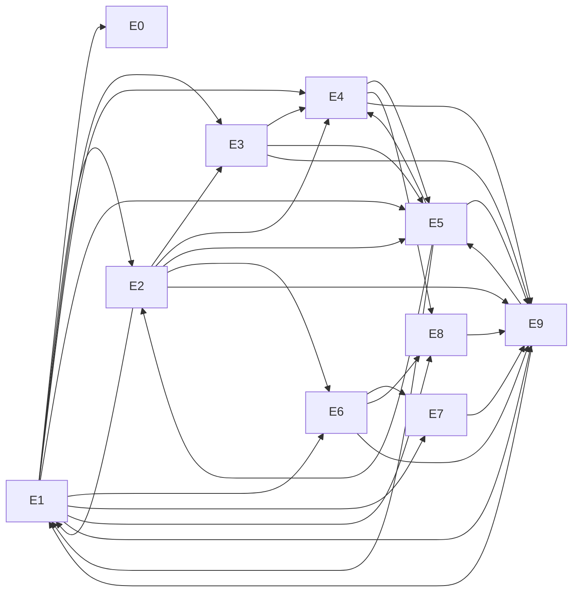

# Roadmap

> **Generated** from the issue drafts that created the GitHub issues. Regenerate it instead of hand-editing. The source of truth for status is [GitHub Issues](https://github.com/marinoscar/local-ai/issues). Each item key (e.g. `AGENT-05`) appears at the bottom of its issue and is the id used in spec §10 breakdowns.

**10 epics, 170 work items.** Phases: **0** foundation → **1** node agent and ark (works fully offline) → **2** cloud and gateway → **3** desktop.

## How to pick the next issue
1. Take the lowest **wave** whose items have all their dependencies merged.
2. Within a wave, prefer `doomsday-critical` items.
3. Each issue is self-contained. Read it, its linked spec sections and [AGENTS.md](../AGENTS.md).

## Epics
| Epic | Title | Items | Doomsday-critical |
|---|---|---|---|
| [#1](https://github.com/marinoscar/local-ai/issues/1) | Foundation: repo, tracking, docs guardrails | 6 | 1 |
| [#2](https://github.com/marinoscar/local-ai/issues/2) | Node agent (aiagent) & CLI (aictl) | 30 | 24 |
| [#3](https://github.com/marinoscar/local-ai/issues/3) | Models & llama.cpp router (swap models, migrate nodes) | 18 | 14 |
| [#4](https://github.com/marinoscar/local-ai/issues/4) | Ark sync & content (models, library, maps, kit) + AI-ARK drive | 15 | 15 |
| [#5](https://github.com/marinoscar/local-ai/issues/5) | Companion services & Survival Portal (library, speech, maps, vision) | 25 | 25 |
| [#6](https://github.com/marinoscar/local-ai/issues/6) | Installer & rebuild kit (online + fully offline install) | 14 | 13 |
| [#7](https://github.com/marinoscar/local-ai/issues/7) | Cloud control app at ai.marin.cr (EnterpriseAppBase) | 21 | 0 |
| [#8](https://github.com/marinoscar/local-ai/issues/8) | Unified OpenAI-compatible gateway at ai.marin.cr/v1 | 12 | 0 |
| [#9](https://github.com/marinoscar/local-ai/issues/9) | ai-desktop app (Electron shell, connected + offline) | 12 | 7 |
| [#10](https://github.com/marinoscar/local-ai/issues/10) | Drills, QA & runbook verification | 17 | 10 |

## Epic dependency graph

## Waves (topological order)
A wave is the length of the longest dependency chain ending at an item. All items in wave *n* can be worked in parallel once waves < *n* are merged.

**Wave 1:** [#11](https://github.com/marinoscar/local-ai/issues/11) `AGENT-01` ⚠, [#75](https://github.com/marinoscar/local-ai/issues/75) `CLOUD-01`, [#118](https://github.com/marinoscar/local-ai/issues/118) `DSK-01`, [#130](https://github.com/marinoscar/local-ai/issues/130) `FND-01`, [#131](https://github.com/marinoscar/local-ai/issues/131) `FND-02`, [#132](https://github.com/marinoscar/local-ai/issues/132) `FND-03`, [#135](https://github.com/marinoscar/local-ai/issues/135) `FND-06`, [#156](https://github.com/marinoscar/local-ai/issues/156) `OPS-01`, [#160](https://github.com/marinoscar/local-ai/issues/160) `OPS-05`

**Wave 2:** [#12](https://github.com/marinoscar/local-ai/issues/12) `AGENT-02` ⚠, [#13](https://github.com/marinoscar/local-ai/issues/13) `AGENT-03` ⚠, [#14](https://github.com/marinoscar/local-ai/issues/14) `AGENT-04`, [#24](https://github.com/marinoscar/local-ai/issues/24) `CAT-01` ⚠, [#76](https://github.com/marinoscar/local-ai/issues/76) `CLOUD-02`, [#77](https://github.com/marinoscar/local-ai/issues/77) `CLOUD-03`, [#78](https://github.com/marinoscar/local-ai/issues/78) `CLOUD-04`, [#119](https://github.com/marinoscar/local-ai/issues/119) `DSK-02` ⚠, [#133](https://github.com/marinoscar/local-ai/issues/133) `FND-04`, [#115](https://github.com/marinoscar/local-ai/issues/115) `INST-01` ⚠, [#60](https://github.com/marinoscar/local-ai/issues/60) `KIT-02` ⚠

**Wave 3:** [#15](https://github.com/marinoscar/local-ai/issues/15) `AGENT-05` ⚠, [#56](https://github.com/marinoscar/local-ai/issues/56) `CAT-04`, [#79](https://github.com/marinoscar/local-ai/issues/79) `CLOUD-05`, [#134](https://github.com/marinoscar/local-ai/issues/134) `FND-05` ⚠, [#136](https://github.com/marinoscar/local-ai/issues/136) `GW-01`

**Wave 4:** [#16](https://github.com/marinoscar/local-ai/issues/16) `AGENT-06` ⚠, [#17](https://github.com/marinoscar/local-ai/issues/17) `AGENT-07`, [#18](https://github.com/marinoscar/local-ai/issues/18) `AGENT-08` ⚠, [#19](https://github.com/marinoscar/local-ai/issues/19) `AGENT-09` ⚠, [#20](https://github.com/marinoscar/local-ai/issues/20) `AGENT-10` ⚠, [#39](https://github.com/marinoscar/local-ai/issues/39) `AICTL-01` ⚠, [#80](https://github.com/marinoscar/local-ai/issues/80) `CLOUD-06`, [#81](https://github.com/marinoscar/local-ai/issues/81) `CLOUD-07`, [#82](https://github.com/marinoscar/local-ai/issues/82) `CLOUD-08`, [#84](https://github.com/marinoscar/local-ai/issues/84) `CLOUD-10`, [#137](https://github.com/marinoscar/local-ai/issues/137) `GW-02`, [#138](https://github.com/marinoscar/local-ai/issues/138) `GW-03`

**Wave 5:** [#21](https://github.com/marinoscar/local-ai/issues/21) `AGENT-11` ⚠, [#22](https://github.com/marinoscar/local-ai/issues/22) `AGENT-12` ⚠, [#34](https://github.com/marinoscar/local-ai/issues/34) `AGENT-16` ⚠, [#40](https://github.com/marinoscar/local-ai/issues/40) `AICTL-02` ⚠, [#41](https://github.com/marinoscar/local-ai/issues/41) `AICTL-03` ⚠, [#83](https://github.com/marinoscar/local-ai/issues/83) `CLOUD-09`, [#85](https://github.com/marinoscar/local-ai/issues/85) `CLOUD-11`, [#91](https://github.com/marinoscar/local-ai/issues/91) `CLOUD-17`, [#120](https://github.com/marinoscar/local-ai/issues/120) `DSK-03` ⚠, [#139](https://github.com/marinoscar/local-ai/issues/139) `GW-04`, [#27](https://github.com/marinoscar/local-ai/issues/27) `ROUTER-01` ⚠, [#25](https://github.com/marinoscar/local-ai/issues/25) `ROUTER-02` ⚠, [#64](https://github.com/marinoscar/local-ai/issues/64) `SVC-02` ⚠

**Wave 6:** [#23](https://github.com/marinoscar/local-ai/issues/23) `AGENT-13` ⚠, [#42](https://github.com/marinoscar/local-ai/issues/42) `AICTL-04` ⚠, [#45](https://github.com/marinoscar/local-ai/issues/45) `AICTL-06` ⚠, [#46](https://github.com/marinoscar/local-ai/issues/46) `AICTL-07` ⚠, [#47](https://github.com/marinoscar/local-ai/issues/47) `AICTL-08` ⚠, [#26](https://github.com/marinoscar/local-ai/issues/26) `CAT-05`, [#86](https://github.com/marinoscar/local-ai/issues/86) `CLOUD-12`, [#87](https://github.com/marinoscar/local-ai/issues/87) `CLOUD-13`, [#88](https://github.com/marinoscar/local-ai/issues/88) `CLOUD-14`, [#89](https://github.com/marinoscar/local-ai/issues/89) `CLOUD-15`, [#90](https://github.com/marinoscar/local-ai/issues/90) `CLOUD-16`, [#92](https://github.com/marinoscar/local-ai/issues/92) `CLOUD-18`, [#68](https://github.com/marinoscar/local-ai/issues/68) `DRILL-01` ⚠, [#121](https://github.com/marinoscar/local-ai/issues/121) `DSK-04`, [#122](https://github.com/marinoscar/local-ai/issues/122) `DSK-05` ⚠, [#123](https://github.com/marinoscar/local-ai/issues/123) `DSK-06` ⚠, [#140](https://github.com/marinoscar/local-ai/issues/140) `GW-05`, [#141](https://github.com/marinoscar/local-ai/issues/141) `GW-06`, [#116](https://github.com/marinoscar/local-ai/issues/116) `INST-03` ⚠, [#110](https://github.com/marinoscar/local-ai/issues/110) `PORTAL-02` ⚠, [#173](https://github.com/marinoscar/local-ai/issues/173) `RB-07` ⚠, [#28](https://github.com/marinoscar/local-ai/issues/28) `ROUTER-03` ⚠, [#65](https://github.com/marinoscar/local-ai/issues/65) `SVC-01` ⚠, [#49](https://github.com/marinoscar/local-ai/issues/49) `SYNC-01` ⚠

**Wave 7:** [#29](https://github.com/marinoscar/local-ai/issues/29) `AGENT-14` ⚠, [#93](https://github.com/marinoscar/local-ai/issues/93) `CLOUD-19`, [#124](https://github.com/marinoscar/local-ai/issues/124) `DSK-07` ⚠, [#127](https://github.com/marinoscar/local-ai/issues/127) `DSK-10`, [#142](https://github.com/marinoscar/local-ai/issues/142) `GW-07`, [#143](https://github.com/marinoscar/local-ai/issues/143) `GW-08`, [#144](https://github.com/marinoscar/local-ai/issues/144) `GW-09`, [#145](https://github.com/marinoscar/local-ai/issues/145) `GW-10`, [#148](https://github.com/marinoscar/local-ai/issues/148) `INST-02` ⚠, [#165](https://github.com/marinoscar/local-ai/issues/165) `PORTAL-12` ⚠, [#175](https://github.com/marinoscar/local-ai/issues/175) `RB-09`, [#30](https://github.com/marinoscar/local-ai/issues/30) `ROUTER-04` ⚠, [#31](https://github.com/marinoscar/local-ai/issues/31) `ROUTER-05` ⚠, [#95](https://github.com/marinoscar/local-ai/issues/95) `SVC-13` ⚠, [#179](https://github.com/marinoscar/local-ai/issues/179) `SYNC-02` ⚠, [#50](https://github.com/marinoscar/local-ai/issues/50) `SYNC-04` ⚠

**Wave 8:** [#35](https://github.com/marinoscar/local-ai/issues/35) `AGENT-17`, [#100](https://github.com/marinoscar/local-ai/issues/100) `DRILL-03` ⚠, [#128](https://github.com/marinoscar/local-ai/issues/128) `DSK-11`, [#147](https://github.com/marinoscar/local-ai/issues/147) `GW-12`, [#111](https://github.com/marinoscar/local-ai/issues/111) `PORTAL-03` ⚠, [#169](https://github.com/marinoscar/local-ai/issues/169) `RB-03`, [#32](https://github.com/marinoscar/local-ai/issues/32) `ROUTER-06` ⚠, [#177](https://github.com/marinoscar/local-ai/issues/177) `ROUTER-07` ⚠, [#43](https://github.com/marinoscar/local-ai/issues/43) `ROUTER-10`, [#103](https://github.com/marinoscar/local-ai/issues/103) `SVC-03` ⚠, [#66](https://github.com/marinoscar/local-ai/issues/66) `SVC-08` ⚠, [#107](https://github.com/marinoscar/local-ai/issues/107) `SVC-09` ⚠, [#180](https://github.com/marinoscar/local-ai/issues/180) `SYNC-03` ⚠, [#51](https://github.com/marinoscar/local-ai/issues/51) `SYNC-05` ⚠, [#55](https://github.com/marinoscar/local-ai/issues/55) `SYNC-06` ⚠

**Wave 9:** [#33](https://github.com/marinoscar/local-ai/issues/33) `AGENT-15`, [#38](https://github.com/marinoscar/local-ai/issues/38) `AGENT-20` ⚠, [#44](https://github.com/marinoscar/local-ai/issues/44) `AICTL-05` ⚠, [#71](https://github.com/marinoscar/local-ai/issues/71) `CAT-02` ⚠, [#69](https://github.com/marinoscar/local-ai/issues/69) `DRILL-06` ⚠, [#146](https://github.com/marinoscar/local-ai/issues/146) `GW-11`, [#52](https://github.com/marinoscar/local-ai/issues/52) `KIT-01` ⚠, [#48](https://github.com/marinoscar/local-ai/issues/48) `ROUTER-08` ⚠, [#104](https://github.com/marinoscar/local-ai/issues/104) `SVC-04` ⚠, [#57](https://github.com/marinoscar/local-ai/issues/57) `SYNC-07` ⚠, [#72](https://github.com/marinoscar/local-ai/issues/72) `SYNC-09` ⚠, [#73](https://github.com/marinoscar/local-ai/issues/73) `SYNC-10` ⚠, [#63](https://github.com/marinoscar/local-ai/issues/63) `SYNC-11` ⚠, [#58](https://github.com/marinoscar/local-ai/issues/58) `SYNC-12` ⚠

**Wave 10:** [#36](https://github.com/marinoscar/local-ai/issues/36) `AGENT-18`, [#74](https://github.com/marinoscar/local-ai/issues/74) `CAT-03` ⚠, [#125](https://github.com/marinoscar/local-ai/issues/125) `DSK-08`, [#53](https://github.com/marinoscar/local-ai/issues/53) `KIT-04` ⚠, [#67](https://github.com/marinoscar/local-ai/issues/67) `KIT-06` ⚠, [#96](https://github.com/marinoscar/local-ai/issues/96) `PORTAL-01` ⚠, [#168](https://github.com/marinoscar/local-ai/issues/168) `RB-02`, [#176](https://github.com/marinoscar/local-ai/issues/176) `RB-10`, [#150](https://github.com/marinoscar/local-ai/issues/150) `ROUTER-09` ⚠, [#101](https://github.com/marinoscar/local-ai/issues/101) `SYNC-08` ⚠

**Wave 11:** [#37](https://github.com/marinoscar/local-ai/issues/37) `AGENT-19`, [#94](https://github.com/marinoscar/local-ai/issues/94) `CLOUD-20`, [#149](https://github.com/marinoscar/local-ai/issues/149) `INST-04` ⚠, [#59](https://github.com/marinoscar/local-ai/issues/59) `KIT-03` ⚠, [#97](https://github.com/marinoscar/local-ai/issues/97) `PORTAL-04` ⚠, [#172](https://github.com/marinoscar/local-ai/issues/172) `RB-06` ⚠, [#61](https://github.com/marinoscar/local-ai/issues/61) `SVC-05` ⚠, [#102](https://github.com/marinoscar/local-ai/issues/102) `SYNC-13` ⚠, [#152](https://github.com/marinoscar/local-ai/issues/152) `SYNC-14` ⚠

**Wave 12:** [#54](https://github.com/marinoscar/local-ai/issues/54) `AICTL-09` ⚠, [#126](https://github.com/marinoscar/local-ai/issues/126) `DSK-09` ⚠, [#151](https://github.com/marinoscar/local-ai/issues/151) `INST-05` ⚠, [#62](https://github.com/marinoscar/local-ai/issues/62) `KIT-05` ⚠, [#98](https://github.com/marinoscar/local-ai/issues/98) `PORTAL-05` ⚠, [#161](https://github.com/marinoscar/local-ai/issues/161) `PORTAL-06` ⚠, [#112](https://github.com/marinoscar/local-ai/issues/112) `PORTAL-09` ⚠, [#166](https://github.com/marinoscar/local-ai/issues/166) `RB-00`, [#170](https://github.com/marinoscar/local-ai/issues/170) `RB-04` ⚠, [#174](https://github.com/marinoscar/local-ai/issues/174) `RB-08`, [#105](https://github.com/marinoscar/local-ai/issues/105) `SVC-06` ⚠

**Wave 13:** [#70](https://github.com/marinoscar/local-ai/issues/70) `AICTL-10` ⚠, [#99](https://github.com/marinoscar/local-ai/issues/99) `DRILL-02` ⚠, [#117](https://github.com/marinoscar/local-ai/issues/117) `DRILL-05` ⚠, [#129](https://github.com/marinoscar/local-ai/issues/129) `DSK-12` ⚠, [#153](https://github.com/marinoscar/local-ai/issues/153) `INST-06` ⚠, [#157](https://github.com/marinoscar/local-ai/issues/157) `OPS-02` ⚠, [#164](https://github.com/marinoscar/local-ai/issues/164) `PORTAL-10` ⚠, [#113](https://github.com/marinoscar/local-ai/issues/113) `PORTAL-11` ⚠, [#167](https://github.com/marinoscar/local-ai/issues/167) `RB-01` ⚠, [#106](https://github.com/marinoscar/local-ai/issues/106) `SVC-07` ⚠, [#108](https://github.com/marinoscar/local-ai/issues/108) `SVC-10` ⚠

**Wave 14:** [#154](https://github.com/marinoscar/local-ai/issues/154) `INST-07`, [#158](https://github.com/marinoscar/local-ai/issues/158) `OPS-03` ⚠, [#162](https://github.com/marinoscar/local-ai/issues/162) `PORTAL-07` ⚠, [#109](https://github.com/marinoscar/local-ai/issues/109) `SVC-11` ⚠, [#178](https://github.com/marinoscar/local-ai/issues/178) `SVC-12` ⚠

**Wave 15:** [#114](https://github.com/marinoscar/local-ai/issues/114) `DRILL-04` ⚠, [#155](https://github.com/marinoscar/local-ai/issues/155) `INST-08` ⚠, [#159](https://github.com/marinoscar/local-ai/issues/159) `OPS-04` ⚠, [#163](https://github.com/marinoscar/local-ai/issues/163) `PORTAL-08` ⚠, [#171](https://github.com/marinoscar/local-ai/issues/171) `RB-05`

⚠ = doomsday-critical

## All items by epic

### [#1](https://github.com/marinoscar/local-ai/issues/1) Foundation: repo, tracking, docs guardrails
| Item | Title | Depends on | Labels |
|---|---|---|---|
| [#130](https://github.com/marinoscar/local-ai/issues/130) `FND-01` | CI guardrails - redaction check, gitleaks, pre-commit hook installer | — | `area:ci` `area:security` `size:S` |
| [#131](https://github.com/marinoscar/local-ai/issues/131) `FND-02` | CI - markdown link checker for docs (offline, relative links + anchors) | — | `area:ci` `size:S` |
| [#132](https://github.com/marinoscar/local-ai/issues/132) `FND-03` | CI - doctor code registry check (scripts/check-doctor-codes.sh) | — | `area:ci` `size:S` |
| [#133](https://github.com/marinoscar/local-ai/issues/133) `FND-04` | CI - Go pipeline for agent/ (vet, test, vendor check, static builds) | [#11](https://github.com/marinoscar/local-ai/issues/11) | `area:ci` `area:agent` `size:S` |
| [#134](https://github.com/marinoscar/local-ai/issues/134) `FND-05` | Release signing - minisign key, SHA256SUMS signing, release workflows skeleton | [#133](https://github.com/marinoscar/local-ai/issues/133) | `area:ci` `area:security` `size:M` `doomsday-critical` |
| [#135](https://github.com/marinoscar/local-ai/issues/135) `FND-06` | Owner task - create inventory.local.yaml on owner machines and the ark drive | — | `area:security` `size:S` `needs-hardware` |

### [#2](https://github.com/marinoscar/local-ai/issues/2) Node agent (aiagent) & CLI (aictl)
| Item | Title | Depends on | Labels |
|---|---|---|---|
| [#11](https://github.com/marinoscar/local-ai/issues/11) `AGENT-01` | Agent skeleton - multi-call binary, app wiring, static builds, vendoring | — | `area:agent` `area:ci` `size:M` `doomsday-critical` |
| [#12](https://github.com/marinoscar/local-ai/issues/12) `AGENT-02` | Agent config store - node.yaml schema, validation, atomic writer, hot reload | [#11](https://github.com/marinoscar/local-ai/issues/11) | `area:agent` `size:M` `doomsday-critical` |
| [#13](https://github.com/marinoscar/local-ai/issues/13) `AGENT-03` | Agent state store - state.json single writer, atomic, .bak, corruption fallback | [#11](https://github.com/marinoscar/local-ai/issues/11) | `area:agent` `size:S` `doomsday-critical` |
| [#14](https://github.com/marinoscar/local-ai/issues/14) `AGENT-04` | Agent logging - slog JSON handler, secret scrubber, append-only audit log | [#11](https://github.com/marinoscar/local-ai/issues/11) | `area:agent` `area:security` `size:M` |
| [#15](https://github.com/marinoscar/local-ai/issues/15) `AGENT-05` | Agent HTTP server - listeners, middleware, Host/Origin/CSRF, error envelope | [#11](https://github.com/marinoscar/local-ai/issues/11), [#12](https://github.com/marinoscar/local-ai/issues/12), [#14](https://github.com/marinoscar/local-ai/issues/14) | `area:agent` `area:security` `size:M` `doomsday-critical` |
| [#16](https://github.com/marinoscar/local-ai/issues/16) `AGENT-06` | Agent auth - tokens, sessions, UI codes, PIN, peer creds, grants | [#11](https://github.com/marinoscar/local-ai/issues/11), [#15](https://github.com/marinoscar/local-ai/issues/15) | `area:agent` `area:security` `size:L` `doomsday-critical` |
| [#17](https://github.com/marinoscar/local-ai/issues/17) `AGENT-07` | Agent OpenAPI - openapi.yaml for all routes, conformance and bijection tests | [#11](https://github.com/marinoscar/local-ai/issues/11), [#15](https://github.com/marinoscar/local-ai/issues/15) | `area:agent` `area:ci` `size:L` |
| [#18](https://github.com/marinoscar/local-ai/issues/18) `AGENT-08` | Agent event bus and SSE endpoint - ring buffer, replay, resync, filters | [#11](https://github.com/marinoscar/local-ai/issues/11), [#15](https://github.com/marinoscar/local-ai/issues/15) | `area:agent` `size:M` `doomsday-critical` |
| [#19](https://github.com/marinoscar/local-ai/issues/19) `AGENT-09` | Agent systemd manager - D-Bus and systemctl fallback, /services, /logs | [#11](https://github.com/marinoscar/local-ai/issues/11), [#15](https://github.com/marinoscar/local-ai/issues/15) | `area:agent` `size:M` `doomsday-critical` `needs-hardware` |
| [#20](https://github.com/marinoscar/local-ai/issues/20) `AGENT-10` | Agent hardware sampler - GPU (NVIDIA/AMD), RAM, disk, battery, thermal, OOM | [#11](https://github.com/marinoscar/local-ai/issues/11), [#15](https://github.com/marinoscar/local-ai/issues/15) | `area:agent` `size:L` `doomsday-critical` `needs-hardware` |
| [#21](https://github.com/marinoscar/local-ai/issues/21) `AGENT-11` | Agent doctor - check registry, codes.go en/es, alerts, /doctor, CI code check | [#18](https://github.com/marinoscar/local-ai/issues/18) | `area:agent` `area:ci` `size:M` `doomsday-critical` |
| [#22](https://github.com/marinoscar/local-ai/issues/22) `AGENT-12` | Agent mode engine - resumable transitions, preemption, /mode, /mode/survival | [#13](https://github.com/marinoscar/local-ai/issues/13), [#16](https://github.com/marinoscar/local-ai/issues/16), [#18](https://github.com/marinoscar/local-ai/issues/18), [#19](https://github.com/marinoscar/local-ai/issues/19) | `area:agent` `size:L` `doomsday-critical` `needs-hardware` |
| [#23](https://github.com/marinoscar/local-ai/issues/23) `AGENT-13` | Agent Tailscale Serve manager and connectivity prober | [#22](https://github.com/marinoscar/local-ai/issues/22) | `area:agent` `area:security` `size:M` `doomsday-critical` `needs-hardware` |
| [#29](https://github.com/marinoscar/local-ai/issues/29) `AGENT-14` | Agent routes - /status, /portal/status, /profile, /catalog | [#17](https://github.com/marinoscar/local-ai/issues/17), [#20](https://github.com/marinoscar/local-ai/issues/20), [#22](https://github.com/marinoscar/local-ai/issues/22), [#24](https://github.com/marinoscar/local-ai/issues/24), [#26](https://github.com/marinoscar/local-ai/issues/26), [#28](https://github.com/marinoscar/local-ai/issues/28) | `area:agent` `size:M` `doomsday-critical` |
| [#33](https://github.com/marinoscar/local-ai/issues/33) `AGENT-15` | Agent routes - /models views, download, delete, /key and /key/rotate | [#29](https://github.com/marinoscar/local-ai/issues/29), [#28](https://github.com/marinoscar/local-ai/issues/28), [#30](https://github.com/marinoscar/local-ai/issues/30), [#31](https://github.com/marinoscar/local-ai/issues/31), [#32](https://github.com/marinoscar/local-ai/issues/32) | `area:agent` `area:security` `size:M` |
| [#34](https://github.com/marinoscar/local-ai/issues/34) `AGENT-16` | Agent proxy and static-path plumbing - reverse-proxy helper, /docs/, path safety, CSP | [#15](https://github.com/marinoscar/local-ai/issues/15), [#16](https://github.com/marinoscar/local-ai/issues/16) | `area:agent` `area:security` `size:M` `doomsday-critical` `needs-hardware` |
| [#35](https://github.com/marinoscar/local-ai/issues/35) `AGENT-17` | Agent cloud link - register, heartbeat, state snapshot, key push, /cloud routes | [#22](https://github.com/marinoscar/local-ai/issues/22), [#29](https://github.com/marinoscar/local-ai/issues/29) | `area:agent` `area:security` `size:L` `needs-hardware` |
| [#36](https://github.com/marinoscar/local-ai/issues/36) `AGENT-18` | Agent cloud link - claim loop, strict job decoders, executors, lease and settle | [#33](https://github.com/marinoscar/local-ai/issues/33), [#35](https://github.com/marinoscar/local-ai/issues/35) | `area:agent` `area:security` `size:L` `needs-hardware` |
| [#37](https://github.com/marinoscar/local-ai/issues/37) `AGENT-19` | Agent self-update - signed release, minisign + sha256, health-checked rollback | [#19](https://github.com/marinoscar/local-ai/issues/19), [#35](https://github.com/marinoscar/local-ai/issues/35), [#36](https://github.com/marinoscar/local-ai/issues/36) | `area:agent` `area:security` `size:L` `needs-hardware` |
| [#38](https://github.com/marinoscar/local-ai/issues/38) `AGENT-20` | Agent startup sequence, graceful shutdown, sd_notify and localai-agent.service | [#21](https://github.com/marinoscar/local-ai/issues/21), [#22](https://github.com/marinoscar/local-ai/issues/22), [#23](https://github.com/marinoscar/local-ai/issues/23), [#35](https://github.com/marinoscar/local-ai/issues/35) | `area:agent` `size:M` `doomsday-critical` `needs-hardware` |
| [#39](https://github.com/marinoscar/local-ai/issues/39) `AICTL-01` | aictl - CLI framework, socket/TCP transport, exit-code map | [#11](https://github.com/marinoscar/local-ai/issues/11), [#15](https://github.com/marinoscar/local-ai/issues/15) | `area:cli` `size:M` `doomsday-critical` |
| [#40](https://github.com/marinoscar/local-ai/issues/40) `AICTL-02` | aictl - output layer, --json writer, confirmations and PIN flow | [#39](https://github.com/marinoscar/local-ai/issues/39) | `area:cli` `size:M` `doomsday-critical` |
| [#41](https://github.com/marinoscar/local-ai/issues/41) `AICTL-03` | aictl - progress display from SSE events, Ctrl-C and resync handling | [#39](https://github.com/marinoscar/local-ai/issues/39), [#18](https://github.com/marinoscar/local-ai/issues/18) | `area:cli` `size:M` `doomsday-critical` |
| [#42](https://github.com/marinoscar/local-ai/issues/42) `AICTL-04` | aictl - read-only commands (status, models, services, logs, doctor, version) | [#40](https://github.com/marinoscar/local-ai/issues/40) | `area:cli` `size:L` `doomsday-critical` `needs-hardware` |
| [#44](https://github.com/marinoscar/local-ai/issues/44) `AICTL-05` | aictl - model and service commands (load, unload, default, delete, bench) | [#41](https://github.com/marinoscar/local-ai/issues/41), [#31](https://github.com/marinoscar/local-ai/issues/31), [#43](https://github.com/marinoscar/local-ai/issues/43) | `area:cli` `size:M` `doomsday-critical` `needs-hardware` |
| [#45](https://github.com/marinoscar/local-ai/issues/45) `AICTL-06` | aictl - key, mode, ark, catalog, profile, cloud, ui-code and drill commands | [#41](https://github.com/marinoscar/local-ai/issues/41) | `area:cli` `size:L` `doomsday-critical` `needs-hardware` |
| [#46](https://github.com/marinoscar/local-ai/issues/46) `AICTL-07` | aictl - local root commands (pin, token, catalog restore/use, backup-config) | [#40](https://github.com/marinoscar/local-ai/issues/40), [#12](https://github.com/marinoscar/local-ai/issues/12), [#14](https://github.com/marinoscar/local-ai/issues/14), [#16](https://github.com/marinoscar/local-ai/issues/16), [#24](https://github.com/marinoscar/local-ai/issues/24) | `area:cli` `area:security` `size:L` `doomsday-critical` |
| [#47](https://github.com/marinoscar/local-ai/issues/47) `AICTL-08` | aictl - docs render (offline HTML/PDF runbooks and survival card) | [#40](https://github.com/marinoscar/local-ai/issues/40) | `area:cli` `area:runbook` `size:M` `doomsday-critical` |
| [#54](https://github.com/marinoscar/local-ai/issues/54) `AICTL-09` | aictl - rebuild-llama and update commands | [#45](https://github.com/marinoscar/local-ai/issues/45), [#48](https://github.com/marinoscar/local-ai/issues/48), [#53](https://github.com/marinoscar/local-ai/issues/53), [#37](https://github.com/marinoscar/local-ai/issues/37) | `area:cli` `size:M` `doomsday-critical` `needs-hardware` |
| [#70](https://github.com/marinoscar/local-ai/issues/70) `AICTL-10` | aictl - surface completion (verify-release, services, drill, kit, help) | [#42](https://github.com/marinoscar/local-ai/issues/42), [#45](https://github.com/marinoscar/local-ai/issues/45), [#37](https://github.com/marinoscar/local-ai/issues/37), [#59](https://github.com/marinoscar/local-ai/issues/59), [#62](https://github.com/marinoscar/local-ai/issues/62), [#67](https://github.com/marinoscar/local-ai/issues/67), [#69](https://github.com/marinoscar/local-ai/issues/69) | `area:cli` `size:M` `doomsday-critical` `needs-hardware` |

### [#3](https://github.com/marinoscar/local-ai/issues/3) Models & llama.cpp router (swap models, migrate nodes)
| Item | Title | Depends on | Labels |
|---|---|---|---|
| [#24](https://github.com/marinoscar/local-ai/issues/24) `CAT-01` | Catalog - schema structs, strict loader, lint rules and aictl catalog lint | [#11](https://github.com/marinoscar/local-ai/issues/11) | `area:catalog` `area:cli` `area:ci` `size:L` `doomsday-critical` |
| [#71](https://github.com/marinoscar/local-ai/issues/71) `CAT-02` | Catalog - populate initial models.yaml with pinned revisions and measured VRAM | [#24](https://github.com/marinoscar/local-ai/issues/24), [#43](https://github.com/marinoscar/local-ai/issues/43) | `area:catalog` `size:M` `needs-hardware` `doomsday-critical` |
| [#56](https://github.com/marinoscar/local-ai/issues/56) `CAT-04` | Catalog - release tagging workflow and stable channel resolution | [#24](https://github.com/marinoscar/local-ai/issues/24) | `area:catalog` `area:ci` `size:S` |
| [#26](https://github.com/marinoscar/local-ai/issues/26) `CAT-05` | Catalog - profile match and suggest, effective plan, loadable with reasons | [#24](https://github.com/marinoscar/local-ai/issues/24), [#20](https://github.com/marinoscar/local-ai/issues/20), [#25](https://github.com/marinoscar/local-ai/issues/25) | `area:catalog` `area:cli` `size:M` |
| [#156](https://github.com/marinoscar/local-ai/issues/156) `OPS-01` | Ops - capture pre-migration facts on ai-n1, ai-n2, ai-n3 (units, flags, VRAM, builds) | — | `area:router` `size:S` `needs-hardware` |
| [#157](https://github.com/marinoscar/local-ai/issues/157) `OPS-02` | Ops - migrate ai-n3 from llama-qwen.service to the agent-managed router | [#156](https://github.com/marinoscar/local-ai/issues/156), [#150](https://github.com/marinoscar/local-ai/issues/150), [#38](https://github.com/marinoscar/local-ai/issues/38), [#151](https://github.com/marinoscar/local-ai/issues/151) | `area:router` `size:M` `needs-hardware` `doomsday-critical` |
| [#158](https://github.com/marinoscar/local-ai/issues/158) `OPS-03` | Ops - migrate ai-n2 from llama-qwen.service to the agent-managed router | [#157](https://github.com/marinoscar/local-ai/issues/157) | `area:router` `size:M` `needs-hardware` `doomsday-critical` |
| [#159](https://github.com/marinoscar/local-ai/issues/159) `OPS-04` | Ops - migrate ai-n1 from llama-qwen.service to the agent-managed router | [#158](https://github.com/marinoscar/local-ai/issues/158) | `area:router` `size:M` `needs-hardware` `doomsday-critical` |
| [#27](https://github.com/marinoscar/local-ai/issues/27) `ROUTER-01` | Router - typed llama-server router client and status watcher | [#11](https://github.com/marinoscar/local-ai/issues/11), [#18](https://github.com/marinoscar/local-ai/issues/18), [#19](https://github.com/marinoscar/local-ai/issues/19) | `area:router` `size:M` `doomsday-critical` |
| [#25](https://github.com/marinoscar/local-ai/issues/25) `ROUTER-02` | Router - static and dynamic fit rules, eviction planner, loadable_reason | [#11](https://github.com/marinoscar/local-ai/issues/11), [#20](https://github.com/marinoscar/local-ai/issues/20) | `area:router` `size:M` `doomsday-critical` |
| [#28](https://github.com/marinoscar/local-ai/issues/28) `ROUTER-03` | Router - models.ini preset generator, env merge and reload-safety rule | [#27](https://github.com/marinoscar/local-ai/issues/27), [#25](https://github.com/marinoscar/local-ai/issues/25), [#24](https://github.com/marinoscar/local-ai/issues/24) | `area:router` `size:L` `doomsday-critical` `needs-hardware` |
| [#30](https://github.com/marinoscar/local-ai/issues/30) `ROUTER-04` | Router - localai-llama unit generator (router + single), env drop-in, cache dir | [#28](https://github.com/marinoscar/local-ai/issues/28), [#19](https://github.com/marinoscar/local-ai/issues/19) | `area:router` `size:M` `doomsday-critical` `needs-hardware` |
| [#31](https://github.com/marinoscar/local-ai/issues/31) `ROUTER-05` | Router - load/unload orchestrator with eviction, rollback and modelOpsMu | [#27](https://github.com/marinoscar/local-ai/issues/27), [#25](https://github.com/marinoscar/local-ai/issues/25), [#28](https://github.com/marinoscar/local-ai/issues/28), [#13](https://github.com/marinoscar/local-ai/issues/13), [#15](https://github.com/marinoscar/local-ai/issues/15), [#17](https://github.com/marinoscar/local-ai/issues/17) | `area:router` `size:L` `doomsday-critical` `needs-hardware` |
| [#32](https://github.com/marinoscar/local-ai/issues/32) `ROUTER-06` | Router - boot reconcile, default model and restore after llama restart or key rotate | [#31](https://github.com/marinoscar/local-ai/issues/31) | `area:router` `size:M` `doomsday-critical` `needs-hardware` |
| [#177](https://github.com/marinoscar/local-ai/issues/177) `ROUTER-07` | Router - single-model fallback mode and router-single switching | [#30](https://github.com/marinoscar/local-ai/issues/30), [#31](https://github.com/marinoscar/local-ai/issues/31) | `area:router` `size:M` `doomsday-critical` `needs-hardware` |
| [#48](https://github.com/marinoscar/local-ai/issues/48) `ROUTER-08` | Router - llama.cpp build manager (cmake per backend, smoke, BUILD.json, switch) | [#30](https://github.com/marinoscar/local-ai/issues/30), [#32](https://github.com/marinoscar/local-ai/issues/32) | `area:router` `size:L` `doomsday-critical` `needs-hardware` |
| [#150](https://github.com/marinoscar/local-ai/issues/150) `ROUTER-09` | Router - legacy llama-qwen migration (M0-M10, rollback R1-R6) | [#28](https://github.com/marinoscar/local-ai/issues/28), [#30](https://github.com/marinoscar/local-ai/issues/30), [#32](https://github.com/marinoscar/local-ai/issues/32), [#48](https://github.com/marinoscar/local-ai/issues/48), [#12](https://github.com/marinoscar/local-ai/issues/12), [#13](https://github.com/marinoscar/local-ai/issues/13) | `area:router` `size:L` `doomsday-critical` `needs-hardware` |
| [#43](https://github.com/marinoscar/local-ai/issues/43) `ROUTER-10` | Router - bench helper measuring VRAM and throughput for catalog min_vram_mib | [#31](https://github.com/marinoscar/local-ai/issues/31) | `area:router` `size:M` `needs-hardware` |

### [#4](https://github.com/marinoscar/local-ai/issues/4) Ark sync & content (models, library, maps, kit) + AI-ARK drive
| Item | Title | Depends on | Labels |
|---|---|---|---|
| [#74](https://github.com/marinoscar/local-ai/issues/74) `CAT-03` | Catalog - populate initial ark content (Kiwix books, maps, places, docs, first aid) | [#24](https://github.com/marinoscar/local-ai/issues/24), [#51](https://github.com/marinoscar/local-ai/issues/51), [#72](https://github.com/marinoscar/local-ai/issues/72), [#73](https://github.com/marinoscar/local-ai/issues/73), [#63](https://github.com/marinoscar/local-ai/issues/63) | `area:catalog` `size:M` `doomsday-critical` `needs-hardware` |
| [#49](https://github.com/marinoscar/local-ai/issues/49) `SYNC-01` | Ark sync - content roots, root ids and ROOT.json | [#11](https://github.com/marinoscar/local-ai/issues/11), [#21](https://github.com/marinoscar/local-ai/issues/21) | `area:ark-sync` `size:S` `doomsday-critical` |
| [#179](https://github.com/marinoscar/local-ai/issues/179) `SYNC-02` | Ark sync - AI-ARK drive detection, classification and GET /ark/drives | [#49](https://github.com/marinoscar/local-ai/issues/49), [#15](https://github.com/marinoscar/local-ai/issues/15), [#18](https://github.com/marinoscar/local-ai/issues/18) | `area:ark-sync` `size:M` `doomsday-critical` `needs-hardware` |
| [#180](https://github.com/marinoscar/local-ai/issues/180) `SYNC-03` | Ark sync - safe eject, drive init, mount and set-profile routes | [#179](https://github.com/marinoscar/local-ai/issues/179), [#16](https://github.com/marinoscar/local-ai/issues/16) | `area:ark-sync` `size:S` `doomsday-critical` `needs-hardware` |
| [#50](https://github.com/marinoscar/local-ai/issues/50) `SYNC-04` | Ark sync - MANIFEST.json, items.json journal and BestCopy index | [#49](https://github.com/marinoscar/local-ai/issues/49), [#24](https://github.com/marinoscar/local-ai/issues/24) | `area:ark-sync` `size:M` `doomsday-critical` |
| [#51](https://github.com/marinoscar/local-ai/issues/51) `SYNC-05` | Ark sync - pure planner, budget rules and dry-run output | [#50](https://github.com/marinoscar/local-ai/issues/50), [#24](https://github.com/marinoscar/local-ai/issues/24), [#15](https://github.com/marinoscar/local-ai/issues/15) | `area:ark-sync` `size:L` `doomsday-critical` |
| [#55](https://github.com/marinoscar/local-ai/issues/55) `SYNC-06` | Ark sync - resumable downloader, streaming sha256, bandwidth limit, retries | [#50](https://github.com/marinoscar/local-ai/issues/50) | `area:ark-sync` `size:L` `doomsday-critical` |
| [#57](https://github.com/marinoscar/local-ai/issues/57) `SYNC-07` | Ark sync - item state machine, atomic swap, quarantine and run engine | [#51](https://github.com/marinoscar/local-ai/issues/51), [#55](https://github.com/marinoscar/local-ai/issues/55), [#18](https://github.com/marinoscar/local-ai/issues/18), [#20](https://github.com/marinoscar/local-ai/issues/20), [#22](https://github.com/marinoscar/local-ai/issues/22), [#23](https://github.com/marinoscar/local-ai/issues/23), [#56](https://github.com/marinoscar/local-ai/issues/56) | `area:ark-sync` `size:L` `doomsday-critical` |
| [#101](https://github.com/marinoscar/local-ai/issues/101) `SYNC-08` | Ark sync - retention.CanDelete, trash purge, quarantine expiry and prune | [#57](https://github.com/marinoscar/local-ai/issues/57), [#16](https://github.com/marinoscar/local-ai/issues/16) | `area:ark-sync` `size:S` `doomsday-critical` |
| [#72](https://github.com/marinoscar/local-ai/issues/72) `SYNC-09` | Ark sync - resolvers for huggingface, url and github_release | [#55](https://github.com/marinoscar/local-ai/issues/55) | `area:ark-sync` `size:M` `doomsday-critical` |
| [#73](https://github.com/marinoscar/local-ai/issues/73) `SYNC-10` | Ark sync - resolvers for kiwix ZIMs and pmtiles_extract maps | [#55](https://github.com/marinoscar/local-ai/issues/55) | `area:ark-sync` `size:M` `doomsday-critical` |
| [#63](https://github.com/marinoscar/local-ai/issues/63) `SYNC-11` | Ark sync - resolvers for git_mirror, apt_closure and repo_docs | [#55](https://github.com/marinoscar/local-ai/issues/55), [#47](https://github.com/marinoscar/local-ai/issues/47) | `area:ark-sync` `size:L` `doomsday-critical` |
| [#58](https://github.com/marinoscar/local-ai/issues/58) `SYNC-12` | Ark sync - READY.json readiness report, colour rules and GET /ark | [#50](https://github.com/marinoscar/local-ai/issues/50), [#51](https://github.com/marinoscar/local-ai/issues/51), [#15](https://github.com/marinoscar/local-ai/issues/15) | `area:ark-sync` `size:S` `doomsday-critical` |
| [#102](https://github.com/marinoscar/local-ai/issues/102) `SYNC-13` | Ark sync - budgeted re-verification (bit rot) and offline import from a drive | [#57](https://github.com/marinoscar/local-ai/issues/57), [#101](https://github.com/marinoscar/local-ai/issues/101), [#58](https://github.com/marinoscar/local-ai/issues/58), [#12](https://github.com/marinoscar/local-ai/issues/12) | `area:ark-sync` `size:M` `doomsday-critical` `needs-hardware` |
| [#152](https://github.com/marinoscar/local-ai/issues/152) `SYNC-14` | Ark sync - drive extras, sync timer units, scheduled exit codes and cloud report | [#57](https://github.com/marinoscar/local-ai/issues/57), [#58](https://github.com/marinoscar/local-ai/issues/58), [#35](https://github.com/marinoscar/local-ai/issues/35), [#36](https://github.com/marinoscar/local-ai/issues/36) | `area:ark-sync` `size:M` `doomsday-critical` `needs-hardware` |

### [#5](https://github.com/marinoscar/local-ai/issues/5) Companion services & Survival Portal (library, speech, maps, vision)
| Item | Title | Depends on | Labels |
|---|---|---|---|
| [#96](https://github.com/marinoscar/local-ai/issues/96) `PORTAL-01` | Portal - status endpoint and capability model (GET /api/v1/portal/status) | [#29](https://github.com/marinoscar/local-ai/issues/29), [#21](https://github.com/marinoscar/local-ai/issues/21), [#65](https://github.com/marinoscar/local-ai/issues/65), [#95](https://github.com/marinoscar/local-ai/issues/95), [#58](https://github.com/marinoscar/local-ai/issues/58) | `area:portal` `size:M` `doomsday-critical` |
| [#110](https://github.com/marinoscar/local-ai/issues/110) `PORTAL-02` | Portal - Portal session cookie, scope allowlist, Origin check, rate limits | [#16](https://github.com/marinoscar/local-ai/issues/16), [#22](https://github.com/marinoscar/local-ai/issues/22) | `area:portal` `area:security` `size:M` `doomsday-critical` |
| [#111](https://github.com/marinoscar/local-ai/issues/111) `PORTAL-03` | Portal - /chat/ key-injecting proxy to the llama WebUI | [#110](https://github.com/marinoscar/local-ai/issues/110), [#31](https://github.com/marinoscar/local-ai/issues/31), [#34](https://github.com/marinoscar/local-ai/issues/34) | `area:portal` `area:security` `size:M` `doomsday-critical` `needs-hardware` |
| [#97](https://github.com/marinoscar/local-ai/issues/97) `PORTAL-04` | Portal - SPA shell, home screen, i18n, accessibility base | [#96](https://github.com/marinoscar/local-ai/issues/96), [#34](https://github.com/marinoscar/local-ai/issues/34) | `area:portal` `size:L` `doomsday-critical` |
| [#98](https://github.com/marinoscar/local-ai/issues/98) `PORTAL-05` | Portal - offline asset enforcement (CSP, build scan, Playwright offline test) | [#97](https://github.com/marinoscar/local-ai/issues/97) | `area:portal` `area:ci` `size:S` `doomsday-critical` |
| [#161](https://github.com/marinoscar/local-ai/issues/161) `PORTAL-06` | Portal - Status and battery screen, Switch brain screen | [#96](https://github.com/marinoscar/local-ai/issues/96), [#110](https://github.com/marinoscar/local-ai/issues/110), [#97](https://github.com/marinoscar/local-ai/issues/97), [#18](https://github.com/marinoscar/local-ai/issues/18) | `area:portal` `size:M` `doomsday-critical` `needs-hardware` |
| [#162](https://github.com/marinoscar/local-ai/issues/162) `PORTAL-07` | Portal - Talk flow (record, browser WAV conversion, STT, streamed chat, TTS) | [#110](https://github.com/marinoscar/local-ai/issues/110), [#111](https://github.com/marinoscar/local-ai/issues/111), [#97](https://github.com/marinoscar/local-ai/issues/97), [#106](https://github.com/marinoscar/local-ai/issues/106), [#66](https://github.com/marinoscar/local-ai/issues/66) | `area:portal` `size:L` `doomsday-critical` `needs-hardware` |
| [#163](https://github.com/marinoscar/local-ai/issues/163) `PORTAL-08` | Portal - Ask about a photo flow (capture, resize, strip EXIF, vision answer) | [#111](https://github.com/marinoscar/local-ai/issues/111), [#161](https://github.com/marinoscar/local-ai/issues/161), [#162](https://github.com/marinoscar/local-ai/issues/162) | `area:portal` `size:M` `doomsday-critical` `needs-hardware` |
| [#112](https://github.com/marinoscar/local-ai/issues/112) `PORTAL-09` | Portal - Library screen (OpenSearch search, books list) and reader frame | [#97](https://github.com/marinoscar/local-ai/issues/97), [#104](https://github.com/marinoscar/local-ai/issues/104) | `area:portal` `size:M` `doomsday-critical` |
| [#164](https://github.com/marinoscar/local-ai/issues/164) `PORTAL-10` | Portal - Maps and Manuals screens, built-in emergency help page | [#112](https://github.com/marinoscar/local-ai/issues/112), [#34](https://github.com/marinoscar/local-ai/issues/34) | `area:portal` `size:S` `doomsday-critical` |
| [#113](https://github.com/marinoscar/local-ai/issues/113) `PORTAL-11` | Portal - First-aid panel (portal_links resolution, availability, ES fallback) | [#24](https://github.com/marinoscar/local-ai/issues/24), [#96](https://github.com/marinoscar/local-ai/issues/96), [#112](https://github.com/marinoscar/local-ai/issues/112), [#103](https://github.com/marinoscar/local-ai/issues/103) | `area:portal` `size:M` `doomsday-critical` |
| [#165](https://github.com/marinoscar/local-ai/issues/165) `PORTAL-12` | Portal - printable one-page Survival card template (EN/ES) | [#47](https://github.com/marinoscar/local-ai/issues/47) | `area:portal` `area:runbook` `size:M` `doomsday-critical` |
| [#65](https://github.com/marinoscar/local-ai/issues/65) `SVC-01` | Companion services - health supervisor, restart budget and GET /services | [#18](https://github.com/marinoscar/local-ai/issues/18), [#19](https://github.com/marinoscar/local-ai/issues/19), [#21](https://github.com/marinoscar/local-ai/issues/21) | `area:services` `size:M` `doomsday-critical` `needs-hardware` |
| [#64](https://github.com/marinoscar/local-ai/issues/64) `SVC-02` | Companion services - kiwix-tools install from kit and localai-kiwix unit | [#11](https://github.com/marinoscar/local-ai/issues/11), [#19](https://github.com/marinoscar/local-ai/issues/19) | `area:services` `size:S` `doomsday-critical` |
| [#103](https://github.com/marinoscar/local-ai/issues/103) `SVC-03` | Companion services - merged and per-root Kiwix library regeneration | [#65](https://github.com/marinoscar/local-ai/issues/65), [#64](https://github.com/marinoscar/local-ai/issues/64), [#50](https://github.com/marinoscar/local-ai/issues/50) | `area:services` `size:M` `doomsday-critical` |
| [#104](https://github.com/marinoscar/local-ai/issues/104) `SVC-04` | Companion services - /library/ reverse proxy, CSP and book map | [#103](https://github.com/marinoscar/local-ai/issues/103), [#34](https://github.com/marinoscar/local-ai/issues/34) | `area:services` `size:S` `doomsday-critical` |
| [#61](https://github.com/marinoscar/local-ai/issues/61) `SVC-05` | Companion services - whisper.cpp builder per backend, rebuild-whisper, unit | [#53](https://github.com/marinoscar/local-ai/issues/53), [#19](https://github.com/marinoscar/local-ai/issues/19) | `area:services` `size:M` `doomsday-critical` `needs-hardware` |
| [#105](https://github.com/marinoscar/local-ai/issues/105) `SVC-06` | Companion services - whisper model selection, GPU-or-CPU rule, whisper.env | [#61](https://github.com/marinoscar/local-ai/issues/61), [#50](https://github.com/marinoscar/local-ai/issues/50), [#20](https://github.com/marinoscar/local-ai/issues/20), [#24](https://github.com/marinoscar/local-ai/issues/24) | `area:services` `size:S` `doomsday-critical` |
| [#106](https://github.com/marinoscar/local-ai/issues/106) `SVC-07` | Companion services - POST /speech/stt (WAV decode, resample, queue, whisper client) | [#105](https://github.com/marinoscar/local-ai/issues/105), [#16](https://github.com/marinoscar/local-ai/issues/16) | `area:services` `size:M` `doomsday-critical` `needs-hardware` |
| [#66](https://github.com/marinoscar/local-ai/issues/66) `SVC-08` | Companion services - Piper install, POST /speech/tts and GET /speech/voices | [#65](https://github.com/marinoscar/local-ai/issues/65), [#50](https://github.com/marinoscar/local-ai/issues/50), [#24](https://github.com/marinoscar/local-ai/issues/24), [#16](https://github.com/marinoscar/local-ai/issues/16) | `area:services` `size:M` `doomsday-critical` |
| [#107](https://github.com/marinoscar/local-ai/issues/107) `SVC-09` | Companion services - pmtiles Range serving, map assets and /maps/catalog.json | [#50](https://github.com/marinoscar/local-ai/issues/50), [#34](https://github.com/marinoscar/local-ai/issues/34), [#65](https://github.com/marinoscar/local-ai/issues/65) | `area:services` `size:M` `doomsday-critical` |
| [#108](https://github.com/marinoscar/local-ai/issues/108) `SVC-10` | Companion services - offline MapLibre map viewer with local style | [#107](https://github.com/marinoscar/local-ai/issues/107), [#98](https://github.com/marinoscar/local-ai/issues/98) | `area:services` `size:L` `doomsday-critical` |
| [#109](https://github.com/marinoscar/local-ai/issues/109) `SVC-11` | Companion services - offline place index, /maps/search and /maps/nearest | [#72](https://github.com/marinoscar/local-ai/issues/72), [#107](https://github.com/marinoscar/local-ai/issues/107), [#108](https://github.com/marinoscar/local-ai/issues/108) | `area:services` `size:M` `doomsday-critical` |
| [#178](https://github.com/marinoscar/local-ai/issues/178) `SVC-12` | Companion services - Where am I (gpsd, NMEA serial, manual location) | [#108](https://github.com/marinoscar/local-ai/issues/108), [#13](https://github.com/marinoscar/local-ai/issues/13), [#15](https://github.com/marinoscar/local-ai/issues/15) | `area:services` `size:M` `doomsday-critical` `needs-hardware` |
| [#95](https://github.com/marinoscar/local-ai/issues/95) `SVC-13` | Companion services - vision wiring, photo model selection and LAI-SVC-040/041 | [#25](https://github.com/marinoscar/local-ai/issues/25), [#28](https://github.com/marinoscar/local-ai/issues/28), [#21](https://github.com/marinoscar/local-ai/issues/21) | `area:services` `size:S` `doomsday-critical` `needs-hardware` |

### [#6](https://github.com/marinoscar/local-ai/issues/6) Installer & rebuild kit (online + fully offline install)
| Item | Title | Depends on | Labels |
|---|---|---|---|
| [#115](https://github.com/marinoscar/local-ai/issues/115) `INST-01` | Installer - driver skeleton, logging, flags, dry-run framework | [#11](https://github.com/marinoscar/local-ai/issues/11) | `area:installer` `size:M` `doomsday-critical` |
| [#148](https://github.com/marinoscar/local-ai/issues/148) `INST-02` | Installer - preflight checks and agent/catalog staging | [#115](https://github.com/marinoscar/local-ai/issues/115), [#24](https://github.com/marinoscar/local-ai/issues/24), [#26](https://github.com/marinoscar/local-ai/issues/26), [#60](https://github.com/marinoscar/local-ai/issues/60) | `area:installer` `size:M` `doomsday-critical` |
| [#116](https://github.com/marinoscar/local-ai/issues/116) `INST-03` | Installer - laptop hardening (P4) and LAI-INS-040..044 checks | [#115](https://github.com/marinoscar/local-ai/issues/115), [#21](https://github.com/marinoscar/local-ai/issues/21) | `area:installer` `size:M` `doomsday-critical` `needs-hardware` |
| [#149](https://github.com/marinoscar/local-ai/issues/149) `INST-04` | Installer - users, dirs, polkit rule, packages and companion binaries | [#115](https://github.com/marinoscar/local-ai/issues/115), [#148](https://github.com/marinoscar/local-ai/issues/148), [#67](https://github.com/marinoscar/local-ai/issues/67) | `area:installer` `size:M` `doomsday-critical` |
| [#151](https://github.com/marinoscar/local-ai/issues/151) `INST-05` | Installer - llama.cpp build or reuse (P7) and migration hand-off (P8) | [#115](https://github.com/marinoscar/local-ai/issues/115), [#149](https://github.com/marinoscar/local-ai/issues/149), [#53](https://github.com/marinoscar/local-ai/issues/53), [#150](https://github.com/marinoscar/local-ai/issues/150) | `area:installer` `size:M` `doomsday-critical` `needs-hardware` |
| [#153](https://github.com/marinoscar/local-ai/issues/153) `INST-06` | Installer - node.yaml, units, agent start, API key, admin PIN, enroll | [#115](https://github.com/marinoscar/local-ai/issues/115), [#149](https://github.com/marinoscar/local-ai/issues/149), [#151](https://github.com/marinoscar/local-ai/issues/151), [#12](https://github.com/marinoscar/local-ai/issues/12), [#38](https://github.com/marinoscar/local-ai/issues/38), [#45](https://github.com/marinoscar/local-ai/issues/45), [#46](https://github.com/marinoscar/local-ai/issues/46), [#30](https://github.com/marinoscar/local-ai/issues/30), [#64](https://github.com/marinoscar/local-ai/issues/64), [#61](https://github.com/marinoscar/local-ai/issues/61), [#152](https://github.com/marinoscar/local-ai/issues/152), [#68](https://github.com/marinoscar/local-ai/issues/68) | `area:installer` `size:M` `doomsday-critical` `needs-hardware` |
| [#154](https://github.com/marinoscar/local-ai/issues/154) `INST-07` | Installer - Tailscale, initial content, summary and VPS checklist | [#153](https://github.com/marinoscar/local-ai/issues/153), [#116](https://github.com/marinoscar/local-ai/issues/116), [#45](https://github.com/marinoscar/local-ai/issues/45), [#51](https://github.com/marinoscar/local-ai/issues/51), [#102](https://github.com/marinoscar/local-ai/issues/102) | `area:installer` `size:M` |
| [#155](https://github.com/marinoscar/local-ai/issues/155) `INST-08` | Installer - uninstall (incl. --restore-legacy) and --repair | [#116](https://github.com/marinoscar/local-ai/issues/116), [#151](https://github.com/marinoscar/local-ai/issues/151), [#153](https://github.com/marinoscar/local-ai/issues/153), [#154](https://github.com/marinoscar/local-ai/issues/154) | `area:installer` `size:M` `doomsday-critical` |
| [#52](https://github.com/marinoscar/local-ai/issues/52) `KIT-01` | Rebuild kit - kit items in ark.yaml, pins.json, kit README and MANIFEST | [#24](https://github.com/marinoscar/local-ai/issues/24), [#50](https://github.com/marinoscar/local-ai/issues/50), [#51](https://github.com/marinoscar/local-ai/issues/51) | `area:rebuild-kit` `size:M` `doomsday-critical` |
| [#60](https://github.com/marinoscar/local-ai/issues/60) `KIT-02` | Rebuild kit - node release CI (binaries, SHA256SUMS, minisign, source tarball) | [#11](https://github.com/marinoscar/local-ai/issues/11) | `area:rebuild-kit` `area:ci` `size:M` `doomsday-critical` |
| [#59](https://github.com/marinoscar/local-ai/issues/59) `KIT-03` | Rebuild kit - kit verification, completeness and aictl kit status|verify | [#52](https://github.com/marinoscar/local-ai/issues/52), [#53](https://github.com/marinoscar/local-ai/issues/53), [#57](https://github.com/marinoscar/local-ai/issues/57), [#58](https://github.com/marinoscar/local-ai/issues/58), [#39](https://github.com/marinoscar/local-ai/issues/39) | `area:rebuild-kit` `size:M` `doomsday-critical` `needs-hardware` |
| [#53](https://github.com/marinoscar/local-ai/issues/53) `KIT-04` | Rebuild kit - rebuild-llama offline source, kit preflight, unprivileged compile | [#48](https://github.com/marinoscar/local-ai/issues/48), [#52](https://github.com/marinoscar/local-ai/issues/52), [#39](https://github.com/marinoscar/local-ai/issues/39) | `area:rebuild-kit` `size:L` `doomsday-critical` `needs-hardware` |
| [#62](https://github.com/marinoscar/local-ai/issues/62) `KIT-05` | Rebuild kit - rebuild-agent, rebuild-whisper kit paths, prebuilt export/restore | [#53](https://github.com/marinoscar/local-ai/issues/53), [#60](https://github.com/marinoscar/local-ai/issues/60), [#37](https://github.com/marinoscar/local-ai/issues/37), [#61](https://github.com/marinoscar/local-ai/issues/61) | `area:rebuild-kit` `size:M` `doomsday-critical` `needs-hardware` |
| [#67](https://github.com/marinoscar/local-ai/issues/67) `KIT-06` | Rebuild kit - offline apt (kit install-debs) and kit install <tool> | [#52](https://github.com/marinoscar/local-ai/issues/52), [#63](https://github.com/marinoscar/local-ai/issues/63), [#39](https://github.com/marinoscar/local-ai/issues/39), [#64](https://github.com/marinoscar/local-ai/issues/64), [#66](https://github.com/marinoscar/local-ai/issues/66) | `area:rebuild-kit` `size:M` `doomsday-critical` |

### [#7](https://github.com/marinoscar/local-ai/issues/7) Cloud control app at ai.marin.cr (EnterpriseAppBase)
| Item | Title | Depends on | Labels |
|---|---|---|---|
| [#75](https://github.com/marinoscar/local-ai/issues/75) `CLOUD-01` | Cloud - scaffold apps/cloud from the EAB starter | — | `area:cloud` `size:M` |
| [#76](https://github.com/marinoscar/local-ai/issues/76) `CLOUD-02` | Cloud - monorepo CI workflow, Renovate rule and aictl build step | [#75](https://github.com/marinoscar/local-ai/issues/75), [#11](https://github.com/marinoscar/local-ai/issues/11) | `area:cloud` `area:ci` `size:S` |
| [#77](https://github.com/marinoscar/local-ai/issues/77) `CLOUD-03` | Cloud - identity, allowlist and Local AI permissions | [#75](https://github.com/marinoscar/local-ai/issues/75) | `area:cloud` `area:security` `size:S` |
| [#78](https://github.com/marinoscar/local-ai/issues/78) `CLOUD-04` | Cloud - Prisma fragments, partial indexes, ownership and node settings seed | [#75](https://github.com/marinoscar/local-ai/issues/75) | `area:cloud` `size:M` |
| [#79](https://github.com/marinoscar/local-ai/issues/79) `CLOUD-05` | Cloud - node binding guard and localai config handshake | [#78](https://github.com/marinoscar/local-ai/issues/78) | `area:cloud` `area:security` `size:M` |
| [#80](https://github.com/marinoscar/local-ai/issues/80) `CLOUD-06` | Cloud - state snapshot ingestion, scrubber and node model projection | [#79](https://github.com/marinoscar/local-ai/issues/79) | `area:cloud` `size:L` |
| [#81](https://github.com/marinoscar/local-ai/issues/81) `CLOUD-07` | Cloud - node llama keys in the EAB credential store | [#79](https://github.com/marinoscar/local-ai/issues/79) | `area:cloud` `area:security` `size:M` |
| [#82](https://github.com/marinoscar/local-ai/issues/82) `CLOUD-08` | Cloud - command plane node side - registry, claim long-poll, leases, sweeper | [#79](https://github.com/marinoscar/local-ai/issues/79) | `area:cloud` `size:L` |
| [#83](https://github.com/marinoscar/local-ai/issues/83) `CLOUD-09` | Cloud - command API for the UI with permissions, refusals and audit | [#82](https://github.com/marinoscar/local-ai/issues/82), [#77](https://github.com/marinoscar/local-ai/issues/77) | `area:cloud` `size:M` |
| [#84](https://github.com/marinoscar/local-ai/issues/84) `CLOUD-10` | Cloud - catalog import, lint, approve and serve to nodes | [#76](https://github.com/marinoscar/local-ai/issues/76), [#78](https://github.com/marinoscar/local-ai/issues/78), [#79](https://github.com/marinoscar/local-ai/issues/79), [#24](https://github.com/marinoscar/local-ai/issues/24) | `area:cloud` `area:catalog` `size:L` |
| [#85](https://github.com/marinoscar/local-ai/issues/85) `CLOUD-11` | Cloud web - Lab overview page, node cards and status chips | [#77](https://github.com/marinoscar/local-ai/issues/77), [#80](https://github.com/marinoscar/local-ai/issues/80) | `area:cloud` `size:M` |
| [#86](https://github.com/marinoscar/local-ai/issues/86) `CLOUD-12` | Cloud web - Node detail page with Models, Ark, Services, Logs, Keys, Settings tabs | [#83](https://github.com/marinoscar/local-ai/issues/83), [#85](https://github.com/marinoscar/local-ai/issues/85) | `area:cloud` `size:L` |
| [#87](https://github.com/marinoscar/local-ai/issues/87) `CLOUD-13` | Cloud web - Catalog list, diff, textarea editor, lint panel and approval | [#84](https://github.com/marinoscar/local-ai/issues/84), [#85](https://github.com/marinoscar/local-ai/issues/85) | `area:cloud` `area:catalog` `size:M` |
| [#88](https://github.com/marinoscar/local-ai/issues/88) `CLOUD-14` | Cloud - Add-node wizard with show-once credential and publish checklist | [#79](https://github.com/marinoscar/local-ai/issues/79), [#81](https://github.com/marinoscar/local-ai/issues/81), [#85](https://github.com/marinoscar/local-ai/issues/85) | `area:cloud` `size:L` |
| [#89](https://github.com/marinoscar/local-ai/issues/89) `CLOUD-15` | Cloud - Alert evaluator, notifications, Alerts page and Ack | [#80](https://github.com/marinoscar/local-ai/issues/80), [#85](https://github.com/marinoscar/local-ai/issues/85) | `area:cloud` `size:L` |
| [#90](https://github.com/marinoscar/local-ai/issues/90) `CLOUD-16` | Cloud - Audit API and audit page for localai actions | [#83](https://github.com/marinoscar/local-ai/issues/83), [#85](https://github.com/marinoscar/local-ai/issues/85) | `area:cloud` `size:S` |
| [#91](https://github.com/marinoscar/local-ai/issues/91) `CLOUD-17` | Cloud - Doctor checks for credentials, aictl, catalog, pending nodes, commands, keys | [#81](https://github.com/marinoscar/local-ai/issues/81), [#82](https://github.com/marinoscar/local-ai/issues/82), [#84](https://github.com/marinoscar/local-ai/issues/84) | `area:cloud` `size:M` |
| [#92](https://github.com/marinoscar/local-ai/issues/92) `CLOUD-18` | Cloud deploy - Route53, deploy/cloud branch, API image with aictl, VPS install | [#75](https://github.com/marinoscar/local-ai/issues/75), [#76](https://github.com/marinoscar/local-ai/issues/76), [#77](https://github.com/marinoscar/local-ai/issues/77), [#78](https://github.com/marinoscar/local-ai/issues/78), [#79](https://github.com/marinoscar/local-ai/issues/79), [#80](https://github.com/marinoscar/local-ai/issues/80), [#81](https://github.com/marinoscar/local-ai/issues/81), [#82](https://github.com/marinoscar/local-ai/issues/82), [#83](https://github.com/marinoscar/local-ai/issues/83), [#84](https://github.com/marinoscar/local-ai/issues/84) | `area:cloud` `area:ci` `area:runbook` `size:L` |
| [#93](https://github.com/marinoscar/local-ai/issues/93) `CLOUD-19` | Cloud (later) - VPS stack-agent that publishes node DNS, vhost and certificate | [#88](https://github.com/marinoscar/local-ai/issues/88), [#92](https://github.com/marinoscar/local-ai/issues/92) | `area:cloud` `area:security` `size:L` |
| [#94](https://github.com/marinoscar/local-ai/issues/94) `CLOUD-20` | Cloud (later) - Move node commands onto EAB targeted jobs | [#82](https://github.com/marinoscar/local-ai/issues/82), [#36](https://github.com/marinoscar/local-ai/issues/36) | `area:cloud` `size:L` |
| [#160](https://github.com/marinoscar/local-ai/issues/160) `OPS-05` | Security - nginx rate limits on node vhosts + Tailscale ACLs to node listeners | — | `area:security` `size:M` `needs-hardware` |

### [#8](https://github.com/marinoscar/local-ai/issues/8) Unified OpenAI-compatible gateway at ai.marin.cr/v1
| Item | Title | Depends on | Labels |
|---|---|---|---|
| [#136](https://github.com/marinoscar/local-ai/issues/136) `GW-01` | Gateway - Prisma data model for keys, usage and model policies | [#78](https://github.com/marinoscar/local-ai/issues/78) | `area:gateway` `size:S` |
| [#137](https://github.com/marinoscar/local-ai/issues/137) `GW-02` | Gateway - key management API and API keys page with show-once token | [#136](https://github.com/marinoscar/local-ai/issues/136), [#77](https://github.com/marinoscar/local-ai/issues/77) | `area:gateway` `area:security` `size:M` |
| [#138](https://github.com/marinoscar/local-ai/issues/138) `GW-03` | Gateway - raw Fastify routes, key auth and OpenAI error mapping | [#136](https://github.com/marinoscar/local-ai/issues/136), [#77](https://github.com/marinoscar/local-ai/issues/77) | `area:gateway` `area:security` `size:M` |
| [#139](https://github.com/marinoscar/local-ai/issues/139) `GW-04` | Gateway - in-memory routing table, candidate selection and health probe | [#136](https://github.com/marinoscar/local-ai/issues/136), [#80](https://github.com/marinoscar/local-ai/issues/80), [#81](https://github.com/marinoscar/local-ai/issues/81) | `area:gateway` `size:L` |
| [#140](https://github.com/marinoscar/local-ai/issues/140) `GW-05` | Gateway - GET /v1/models and /v1/models/{id} from the routing table | [#138](https://github.com/marinoscar/local-ai/issues/138), [#139](https://github.com/marinoscar/local-ai/issues/139) | `area:gateway` `size:S` |
| [#141](https://github.com/marinoscar/local-ai/issues/141) `GW-06` | Gateway - non-stream proxy, upstream client and attempt loop with retries | [#138](https://github.com/marinoscar/local-ai/issues/138), [#139](https://github.com/marinoscar/local-ai/issues/139) | `area:gateway` `size:L` |
| [#142](https://github.com/marinoscar/local-ai/issues/142) `GW-07` | Gateway - streaming SSE passthrough with backpressure, abort and timeouts | [#141](https://github.com/marinoscar/local-ai/issues/141) | `area:gateway` `size:L` |
| [#143](https://github.com/marinoscar/local-ai/issues/143) `GW-08` | Gateway - rate limits, token budgets, usage recorder and usage page | [#141](https://github.com/marinoscar/local-ai/issues/141) | `area:gateway` `area:security` `size:M` |
| [#144](https://github.com/marinoscar/local-ai/issues/144) `GW-09` | Gateway - model policies API and page, on-demand load with busy-eviction guard | [#140](https://github.com/marinoscar/local-ai/issues/140), [#82](https://github.com/marinoscar/local-ai/issues/82), [#137](https://github.com/marinoscar/local-ai/issues/137) | `area:gateway` `size:M` |
| [#145](https://github.com/marinoscar/local-ai/issues/145) `GW-10` | Gateway - audio transcriptions route and tailnet upstream mode | [#141](https://github.com/marinoscar/local-ai/issues/141) | `area:gateway` `size:M` |
| [#146](https://github.com/marinoscar/local-ai/issues/146) `GW-11` | Gateway - Open WebUI and client cutover to one lab connection | [#137](https://github.com/marinoscar/local-ai/issues/137), [#142](https://github.com/marinoscar/local-ai/issues/142), [#143](https://github.com/marinoscar/local-ai/issues/143), [#92](https://github.com/marinoscar/local-ai/issues/92), [#35](https://github.com/marinoscar/local-ai/issues/35) | `area:gateway` `area:runbook` `size:S` `needs-hardware` |
| [#147](https://github.com/marinoscar/local-ai/issues/147) `GW-12` | Gateway - k6 load testing harness with fake-upstream build flag | [#142](https://github.com/marinoscar/local-ai/issues/142) | `area:gateway` `size:M` |

### [#9](https://github.com/marinoscar/local-ai/issues/9) ai-desktop app (Electron shell, connected + offline)
| Item | Title | Depends on | Labels |
|---|---|---|---|
| [#118](https://github.com/marinoscar/local-ai/issues/118) `DSK-01` | Desktop - scaffold apps/desktop with electron-vite, builder config, fuses and CI | — | `area:desktop` `area:ci` `size:M` |
| [#119](https://github.com/marinoscar/local-ai/issues/119) `DSK-02` | Desktop - egress guard, navigation allowlists, CSP and localai protocol | [#118](https://github.com/marinoscar/local-ai/issues/118) | `area:desktop` `area:security` `size:M` `doomsday-critical` |
| [#120](https://github.com/marinoscar/local-ai/issues/120) `DSK-03` | Desktop - agent client, start-up sequence, error pages and --diagnose | [#119](https://github.com/marinoscar/local-ai/issues/119), [#16](https://github.com/marinoscar/local-ai/issues/16), [#18](https://github.com/marinoscar/local-ai/issues/18) | `area:desktop` `size:L` `doomsday-critical` `needs-hardware` |
| [#121](https://github.com/marinoscar/local-ai/issues/121) `DSK-04` | Desktop - main window, top bar, child windows and preload bridges | [#120](https://github.com/marinoscar/local-ai/issues/120) | `area:desktop` `area:security` `size:M` |
| [#122](https://github.com/marinoscar/local-ai/issues/122) `DSK-05` | Desktop - Start agent via systemctl with pkexec fallback | [#120](https://github.com/marinoscar/local-ai/issues/120) | `area:desktop` `size:S` `doomsday-critical` `needs-hardware` |
| [#123](https://github.com/marinoscar/local-ai/issues/123) `DSK-06` | Desktop - tray icon, status colours, mode switch and native notifications | [#120](https://github.com/marinoscar/local-ai/issues/120), [#22](https://github.com/marinoscar/local-ai/issues/22) | `area:desktop` `size:M` `doomsday-critical` `needs-hardware` |
| [#124](https://github.com/marinoscar/local-ai/issues/124) `DSK-07` | Desktop - start at login and the --hidden flag | [#123](https://github.com/marinoscar/local-ai/issues/123) | `area:desktop` `size:S` `doomsday-critical` `needs-hardware` |
| [#125](https://github.com/marinoscar/local-ai/issues/125) `DSK-08` | Desktop - Copy API key, connection info page and native PIN prompt | [#121](https://github.com/marinoscar/local-ai/issues/121), [#33](https://github.com/marinoscar/local-ai/issues/33) | `area:desktop` `area:security` `size:M` |
| [#126](https://github.com/marinoscar/local-ai/issues/126) `DSK-09` | Desktop - survival UX with the full-screen Survival Portal | [#121](https://github.com/marinoscar/local-ai/issues/121), [#123](https://github.com/marinoscar/local-ai/issues/123), [#97](https://github.com/marinoscar/local-ai/issues/97) | `area:desktop` `area:portal` `size:M` `doomsday-critical` `needs-hardware` |
| [#127](https://github.com/marinoscar/local-ai/issues/127) `DSK-10` | Desktop - connected mode with device-code link, token storage and egress switch | [#119](https://github.com/marinoscar/local-ai/issues/119), [#121](https://github.com/marinoscar/local-ai/issues/121) | `area:desktop` `area:security` `size:M` |
| [#128](https://github.com/marinoscar/local-ai/issues/128) `DSK-11` | Desktop - Lab tab with allowlisted cloud API proxy and offline cache | [#127](https://github.com/marinoscar/local-ai/issues/127), [#83](https://github.com/marinoscar/local-ai/issues/83), [#85](https://github.com/marinoscar/local-ai/issues/85) | `area:desktop` `area:security` `size:M` |
| [#129](https://github.com/marinoscar/local-ai/issues/129) `DSK-12` | Desktop - release workflow, SHA256SUMS with minisign, kit bump and opt-in updater | [#118](https://github.com/marinoscar/local-ai/issues/118), [#119](https://github.com/marinoscar/local-ai/issues/119), [#120](https://github.com/marinoscar/local-ai/issues/120), [#121](https://github.com/marinoscar/local-ai/issues/121), [#122](https://github.com/marinoscar/local-ai/issues/122), [#123](https://github.com/marinoscar/local-ai/issues/123), [#124](https://github.com/marinoscar/local-ai/issues/124), [#125](https://github.com/marinoscar/local-ai/issues/125), [#126](https://github.com/marinoscar/local-ai/issues/126) | `area:desktop` `area:ci` `area:rebuild-kit` `size:M` `doomsday-critical` |

### [#10](https://github.com/marinoscar/local-ai/issues/10) Drills, QA & runbook verification
| Item | Title | Depends on | Labels |
|---|---|---|---|
| [#68](https://github.com/marinoscar/local-ai/issues/68) `DRILL-01` | Drill - framework, results file, /drill API, handlers and units | [#13](https://github.com/marinoscar/local-ai/issues/13), [#15](https://github.com/marinoscar/local-ai/issues/15), [#16](https://github.com/marinoscar/local-ai/issues/16), [#18](https://github.com/marinoscar/local-ai/issues/18), [#22](https://github.com/marinoscar/local-ai/issues/22) | `area:drill` `size:M` `doomsday-critical` |
| [#99](https://github.com/marinoscar/local-ai/issues/99) `DRILL-02` | Drill - network fence (check 1) and offline config lint (check 2) | [#68](https://github.com/marinoscar/local-ai/issues/68), [#98](https://github.com/marinoscar/local-ai/issues/98) | `area:drill` `size:M` `doomsday-critical` |
| [#100](https://github.com/marinoscar/local-ai/issues/100) `DRILL-03` | Drill - state capture/restore and model checks 5-7 (LLM, photo, fit) | [#68](https://github.com/marinoscar/local-ai/issues/68), [#25](https://github.com/marinoscar/local-ai/issues/25), [#31](https://github.com/marinoscar/local-ai/issues/31) | `area:drill` `size:M` `doomsday-critical` `needs-hardware` |
| [#114](https://github.com/marinoscar/local-ai/issues/114) `DRILL-04` | Drill - content, library, speech, maps, portal, docs and service checks | [#68](https://github.com/marinoscar/local-ai/issues/68), [#102](https://github.com/marinoscar/local-ai/issues/102), [#65](https://github.com/marinoscar/local-ai/issues/65), [#104](https://github.com/marinoscar/local-ai/issues/104), [#106](https://github.com/marinoscar/local-ai/issues/106), [#66](https://github.com/marinoscar/local-ai/issues/66), [#107](https://github.com/marinoscar/local-ai/issues/107), [#109](https://github.com/marinoscar/local-ai/issues/109), [#96](https://github.com/marinoscar/local-ai/issues/96), [#111](https://github.com/marinoscar/local-ai/issues/111), [#113](https://github.com/marinoscar/local-ai/issues/113) | `area:drill` `size:M` `doomsday-critical` `needs-hardware` |
| [#117](https://github.com/marinoscar/local-ai/issues/117) `DRILL-05` | Drill - kit present, rebuild dry-run, power and clock checks | [#68](https://github.com/marinoscar/local-ai/issues/68), [#59](https://github.com/marinoscar/local-ai/issues/59), [#53](https://github.com/marinoscar/local-ai/issues/53), [#62](https://github.com/marinoscar/local-ai/issues/62), [#116](https://github.com/marinoscar/local-ai/issues/116) | `area:drill` `size:S` `doomsday-critical` |
| [#69](https://github.com/marinoscar/local-ai/issues/69) `DRILL-06` | Drill - alerts, cloud snapshot block, record-manual and pull-the-plug runbook | [#68](https://github.com/marinoscar/local-ai/issues/68), [#21](https://github.com/marinoscar/local-ai/issues/21), [#35](https://github.com/marinoscar/local-ai/issues/35), [#40](https://github.com/marinoscar/local-ai/issues/40) | `area:drill` `area:runbook` `size:M` `doomsday-critical` `needs-hardware` |
| [#166](https://github.com/marinoscar/local-ai/issues/166) `RB-00` | Runbook verification - 00 START HERE + runbook index | [#38](https://github.com/marinoscar/local-ai/issues/38), [#97](https://github.com/marinoscar/local-ai/issues/97) | `area:runbook` `size:S` `needs-hardware` |
| [#167](https://github.com/marinoscar/local-ai/issues/167) `RB-01` | Runbook verification - 01 survival mode (EN + ES, printable) | [#165](https://github.com/marinoscar/local-ai/issues/165), [#95](https://github.com/marinoscar/local-ai/issues/95), [#126](https://github.com/marinoscar/local-ai/issues/126) | `area:runbook` `size:S` `needs-hardware` `doomsday-critical` |
| [#168](https://github.com/marinoscar/local-ai/issues/168) `RB-02` | Runbook verification - 02 chat and API keys | [#33](https://github.com/marinoscar/local-ai/issues/33), [#146](https://github.com/marinoscar/local-ai/issues/146) | `area:runbook` `size:S` `needs-hardware` |
| [#169](https://github.com/marinoscar/local-ai/issues/169) `RB-03` | Runbook verification - 03 swap a model | [#31](https://github.com/marinoscar/local-ai/issues/31), [#86](https://github.com/marinoscar/local-ai/issues/86), [#121](https://github.com/marinoscar/local-ai/issues/121) | `area:runbook` `size:S` `needs-hardware` |
| [#170](https://github.com/marinoscar/local-ai/issues/170) `RB-04` | Runbook verification - 04 ark drive (format, fill, eject, import) | [#152](https://github.com/marinoscar/local-ai/issues/152), [#102](https://github.com/marinoscar/local-ai/issues/102) | `area:runbook` `size:S` `needs-hardware` `doomsday-critical` |
| [#171](https://github.com/marinoscar/local-ai/issues/171) `RB-05` | Runbook verification - 05 add a node (fresh machine + VPS publishing) | [#154](https://github.com/marinoscar/local-ai/issues/154), [#88](https://github.com/marinoscar/local-ai/issues/88) | `area:runbook` `size:S` `needs-hardware` |
| [#172](https://github.com/marinoscar/local-ai/issues/172) `RB-06` | Runbook verification - 06 rebuild a node offline from the AI-ARK drive | [#148](https://github.com/marinoscar/local-ai/issues/148), [#67](https://github.com/marinoscar/local-ai/issues/67), [#53](https://github.com/marinoscar/local-ai/issues/53) | `area:runbook` `size:S` `needs-hardware` `doomsday-critical` |
| [#173](https://github.com/marinoscar/local-ai/issues/173) `RB-07` | Runbook verification - 07 troubleshooting (symptoms + doctor codes) | [#21](https://github.com/marinoscar/local-ai/issues/21) | `area:runbook` `size:S` `needs-hardware` `doomsday-critical` |
| [#174](https://github.com/marinoscar/local-ai/issues/174) `RB-08` | Runbook verification - 08 scheduled sync + monthly/quarterly drills | [#152](https://github.com/marinoscar/local-ai/issues/152), [#69](https://github.com/marinoscar/local-ai/issues/69) | `area:runbook` `size:S` `needs-hardware` |
| [#175](https://github.com/marinoscar/local-ai/issues/175) `RB-09` | Runbook verification - 09 laptop as server (hardening) | [#116](https://github.com/marinoscar/local-ai/issues/116) | `area:runbook` `size:S` `needs-hardware` |
| [#176](https://github.com/marinoscar/local-ai/issues/176) `RB-10` | Runbook verification - 10 lab operations (cloud dashboard, routines) | [#92](https://github.com/marinoscar/local-ai/issues/92), [#146](https://github.com/marinoscar/local-ai/issues/146) | `area:runbook` `size:S` `needs-hardware` |

## Spec → item coverage
| Spec | Items |
|---|---|
| [agent.md](specs/agent.md) | [#11](https://github.com/marinoscar/local-ai/issues/11), [#12](https://github.com/marinoscar/local-ai/issues/12), [#13](https://github.com/marinoscar/local-ai/issues/13), [#14](https://github.com/marinoscar/local-ai/issues/14), [#15](https://github.com/marinoscar/local-ai/issues/15), [#16](https://github.com/marinoscar/local-ai/issues/16), [#17](https://github.com/marinoscar/local-ai/issues/17), [#18](https://github.com/marinoscar/local-ai/issues/18), [#19](https://github.com/marinoscar/local-ai/issues/19), [#20](https://github.com/marinoscar/local-ai/issues/20), [#21](https://github.com/marinoscar/local-ai/issues/21), [#22](https://github.com/marinoscar/local-ai/issues/22), [#23](https://github.com/marinoscar/local-ai/issues/23), [#29](https://github.com/marinoscar/local-ai/issues/29), [#33](https://github.com/marinoscar/local-ai/issues/33), [#34](https://github.com/marinoscar/local-ai/issues/34), [#35](https://github.com/marinoscar/local-ai/issues/35), [#36](https://github.com/marinoscar/local-ai/issues/36), [#37](https://github.com/marinoscar/local-ai/issues/37), [#38](https://github.com/marinoscar/local-ai/issues/38) |
| [aictl.md](specs/aictl.md) | [#39](https://github.com/marinoscar/local-ai/issues/39), [#40](https://github.com/marinoscar/local-ai/issues/40), [#41](https://github.com/marinoscar/local-ai/issues/41), [#42](https://github.com/marinoscar/local-ai/issues/42), [#44](https://github.com/marinoscar/local-ai/issues/44), [#45](https://github.com/marinoscar/local-ai/issues/45), [#46](https://github.com/marinoscar/local-ai/issues/46), [#47](https://github.com/marinoscar/local-ai/issues/47), [#54](https://github.com/marinoscar/local-ai/issues/54), [#70](https://github.com/marinoscar/local-ai/issues/70) |
| [catalog.md](specs/catalog.md) | [#24](https://github.com/marinoscar/local-ai/issues/24), [#71](https://github.com/marinoscar/local-ai/issues/71), [#74](https://github.com/marinoscar/local-ai/issues/74), [#56](https://github.com/marinoscar/local-ai/issues/56), [#26](https://github.com/marinoscar/local-ai/issues/26) |
| [cloud-app.md](specs/cloud-app.md) | [#75](https://github.com/marinoscar/local-ai/issues/75), [#76](https://github.com/marinoscar/local-ai/issues/76), [#77](https://github.com/marinoscar/local-ai/issues/77), [#78](https://github.com/marinoscar/local-ai/issues/78), [#79](https://github.com/marinoscar/local-ai/issues/79), [#80](https://github.com/marinoscar/local-ai/issues/80), [#81](https://github.com/marinoscar/local-ai/issues/81), [#82](https://github.com/marinoscar/local-ai/issues/82), [#83](https://github.com/marinoscar/local-ai/issues/83), [#84](https://github.com/marinoscar/local-ai/issues/84), [#85](https://github.com/marinoscar/local-ai/issues/85), [#86](https://github.com/marinoscar/local-ai/issues/86), [#87](https://github.com/marinoscar/local-ai/issues/87), [#88](https://github.com/marinoscar/local-ai/issues/88), [#89](https://github.com/marinoscar/local-ai/issues/89), [#90](https://github.com/marinoscar/local-ai/issues/90), [#91](https://github.com/marinoscar/local-ai/issues/91), [#92](https://github.com/marinoscar/local-ai/issues/92), [#93](https://github.com/marinoscar/local-ai/issues/93), [#94](https://github.com/marinoscar/local-ai/issues/94) |
| [drill.md](specs/drill.md) | [#68](https://github.com/marinoscar/local-ai/issues/68), [#99](https://github.com/marinoscar/local-ai/issues/99), [#100](https://github.com/marinoscar/local-ai/issues/100), [#114](https://github.com/marinoscar/local-ai/issues/114), [#117](https://github.com/marinoscar/local-ai/issues/117), [#69](https://github.com/marinoscar/local-ai/issues/69) |
| [desktop.md](specs/desktop.md) | [#118](https://github.com/marinoscar/local-ai/issues/118), [#119](https://github.com/marinoscar/local-ai/issues/119), [#120](https://github.com/marinoscar/local-ai/issues/120), [#121](https://github.com/marinoscar/local-ai/issues/121), [#122](https://github.com/marinoscar/local-ai/issues/122), [#123](https://github.com/marinoscar/local-ai/issues/123), [#124](https://github.com/marinoscar/local-ai/issues/124), [#125](https://github.com/marinoscar/local-ai/issues/125), [#126](https://github.com/marinoscar/local-ai/issues/126), [#127](https://github.com/marinoscar/local-ai/issues/127), [#128](https://github.com/marinoscar/local-ai/issues/128), [#129](https://github.com/marinoscar/local-ai/issues/129) |
| (repo foundation) | [#130](https://github.com/marinoscar/local-ai/issues/130), [#131](https://github.com/marinoscar/local-ai/issues/131), [#132](https://github.com/marinoscar/local-ai/issues/132), [#133](https://github.com/marinoscar/local-ai/issues/133), [#134](https://github.com/marinoscar/local-ai/issues/134), [#135](https://github.com/marinoscar/local-ai/issues/135) |
| [gateway.md](specs/gateway.md) | [#136](https://github.com/marinoscar/local-ai/issues/136), [#137](https://github.com/marinoscar/local-ai/issues/137), [#138](https://github.com/marinoscar/local-ai/issues/138), [#139](https://github.com/marinoscar/local-ai/issues/139), [#140](https://github.com/marinoscar/local-ai/issues/140), [#141](https://github.com/marinoscar/local-ai/issues/141), [#142](https://github.com/marinoscar/local-ai/issues/142), [#143](https://github.com/marinoscar/local-ai/issues/143), [#144](https://github.com/marinoscar/local-ai/issues/144), [#145](https://github.com/marinoscar/local-ai/issues/145), [#146](https://github.com/marinoscar/local-ai/issues/146), [#147](https://github.com/marinoscar/local-ai/issues/147) |
| [installer.md](specs/installer.md) | [#115](https://github.com/marinoscar/local-ai/issues/115), [#148](https://github.com/marinoscar/local-ai/issues/148), [#116](https://github.com/marinoscar/local-ai/issues/116), [#149](https://github.com/marinoscar/local-ai/issues/149), [#151](https://github.com/marinoscar/local-ai/issues/151), [#153](https://github.com/marinoscar/local-ai/issues/153), [#154](https://github.com/marinoscar/local-ai/issues/154), [#155](https://github.com/marinoscar/local-ai/issues/155) |
| [rebuild-kit.md](specs/rebuild-kit.md) | [#52](https://github.com/marinoscar/local-ai/issues/52), [#60](https://github.com/marinoscar/local-ai/issues/60), [#59](https://github.com/marinoscar/local-ai/issues/59), [#53](https://github.com/marinoscar/local-ai/issues/53), [#62](https://github.com/marinoscar/local-ai/issues/62), [#67](https://github.com/marinoscar/local-ai/issues/67) |
| (operations) | [#156](https://github.com/marinoscar/local-ai/issues/156), [#157](https://github.com/marinoscar/local-ai/issues/157), [#158](https://github.com/marinoscar/local-ai/issues/158), [#159](https://github.com/marinoscar/local-ai/issues/159), [#160](https://github.com/marinoscar/local-ai/issues/160) |
| [survival-portal.md](specs/survival-portal.md) | [#96](https://github.com/marinoscar/local-ai/issues/96), [#110](https://github.com/marinoscar/local-ai/issues/110), [#111](https://github.com/marinoscar/local-ai/issues/111), [#97](https://github.com/marinoscar/local-ai/issues/97), [#98](https://github.com/marinoscar/local-ai/issues/98), [#161](https://github.com/marinoscar/local-ai/issues/161), [#162](https://github.com/marinoscar/local-ai/issues/162), [#163](https://github.com/marinoscar/local-ai/issues/163), [#112](https://github.com/marinoscar/local-ai/issues/112), [#164](https://github.com/marinoscar/local-ai/issues/164), [#113](https://github.com/marinoscar/local-ai/issues/113), [#165](https://github.com/marinoscar/local-ai/issues/165) |
| (runbooks) | [#166](https://github.com/marinoscar/local-ai/issues/166), [#167](https://github.com/marinoscar/local-ai/issues/167), [#168](https://github.com/marinoscar/local-ai/issues/168), [#169](https://github.com/marinoscar/local-ai/issues/169), [#170](https://github.com/marinoscar/local-ai/issues/170), [#171](https://github.com/marinoscar/local-ai/issues/171), [#172](https://github.com/marinoscar/local-ai/issues/172), [#173](https://github.com/marinoscar/local-ai/issues/173), [#174](https://github.com/marinoscar/local-ai/issues/174), [#175](https://github.com/marinoscar/local-ai/issues/175), [#176](https://github.com/marinoscar/local-ai/issues/176) |
| [llama-router.md](specs/llama-router.md) | [#27](https://github.com/marinoscar/local-ai/issues/27), [#25](https://github.com/marinoscar/local-ai/issues/25), [#28](https://github.com/marinoscar/local-ai/issues/28), [#30](https://github.com/marinoscar/local-ai/issues/30), [#31](https://github.com/marinoscar/local-ai/issues/31), [#32](https://github.com/marinoscar/local-ai/issues/32), [#177](https://github.com/marinoscar/local-ai/issues/177), [#48](https://github.com/marinoscar/local-ai/issues/48), [#150](https://github.com/marinoscar/local-ai/issues/150), [#43](https://github.com/marinoscar/local-ai/issues/43) |
| [companion-services.md](specs/companion-services.md) | [#65](https://github.com/marinoscar/local-ai/issues/65), [#64](https://github.com/marinoscar/local-ai/issues/64), [#103](https://github.com/marinoscar/local-ai/issues/103), [#104](https://github.com/marinoscar/local-ai/issues/104), [#61](https://github.com/marinoscar/local-ai/issues/61), [#105](https://github.com/marinoscar/local-ai/issues/105), [#106](https://github.com/marinoscar/local-ai/issues/106), [#66](https://github.com/marinoscar/local-ai/issues/66), [#107](https://github.com/marinoscar/local-ai/issues/107), [#108](https://github.com/marinoscar/local-ai/issues/108), [#109](https://github.com/marinoscar/local-ai/issues/109), [#178](https://github.com/marinoscar/local-ai/issues/178), [#95](https://github.com/marinoscar/local-ai/issues/95) |
| [ark-sync.md](specs/ark-sync.md) | [#49](https://github.com/marinoscar/local-ai/issues/49), [#179](https://github.com/marinoscar/local-ai/issues/179), [#180](https://github.com/marinoscar/local-ai/issues/180), [#50](https://github.com/marinoscar/local-ai/issues/50), [#51](https://github.com/marinoscar/local-ai/issues/51), [#55](https://github.com/marinoscar/local-ai/issues/55), [#57](https://github.com/marinoscar/local-ai/issues/57), [#101](https://github.com/marinoscar/local-ai/issues/101), [#72](https://github.com/marinoscar/local-ai/issues/72), [#73](https://github.com/marinoscar/local-ai/issues/73), [#63](https://github.com/marinoscar/local-ai/issues/63), [#58](https://github.com/marinoscar/local-ai/issues/58), [#102](https://github.com/marinoscar/local-ai/issues/102), [#152](https://github.com/marinoscar/local-ai/issues/152) |

## Critical path (longest chain)
[#11](https://github.com/marinoscar/local-ai/issues/11) `AGENT-01` → [#12](https://github.com/marinoscar/local-ai/issues/12) `AGENT-02` → [#15](https://github.com/marinoscar/local-ai/issues/15) `AGENT-05` → [#18](https://github.com/marinoscar/local-ai/issues/18) `AGENT-08` → [#21](https://github.com/marinoscar/local-ai/issues/21) `AGENT-11` → [#49](https://github.com/marinoscar/local-ai/issues/49) `SYNC-01` → [#50](https://github.com/marinoscar/local-ai/issues/50) `SYNC-04` → [#51](https://github.com/marinoscar/local-ai/issues/51) `SYNC-05` → [#58](https://github.com/marinoscar/local-ai/issues/58) `SYNC-12` → [#96](https://github.com/marinoscar/local-ai/issues/96) `PORTAL-01` → [#97](https://github.com/marinoscar/local-ai/issues/97) `PORTAL-04` → [#98](https://github.com/marinoscar/local-ai/issues/98) `PORTAL-05` → [#108](https://github.com/marinoscar/local-ai/issues/108) `SVC-10` → [#109](https://github.com/marinoscar/local-ai/issues/109) `SVC-11` → [#114](https://github.com/marinoscar/local-ai/issues/114) `DRILL-04`

## External dependencies
- **EnterpriseAppBase seam requests** SR-1 (targeted jobs), SR-2 (bind a credential to one node) and SR-3 (`appctl deploy --app-dir`). File them in `marinoscar/EnterpriseAppBase`, following [#75](https://github.com/marinoscar/local-ai/issues/75). The interim designs in [cloud-app.md](specs/cloud-app.md) mean nothing is blocked except [#94](https://github.com/marinoscar/local-ai/issues/94).
- **VPS changes** (nginx vhosts, rate limits, ACLs) land in the private `marin-server-infra` repo, linked from [#160](https://github.com/marinoscar/local-ai/issues/160) and [#92](https://github.com/marinoscar/local-ai/issues/92).
