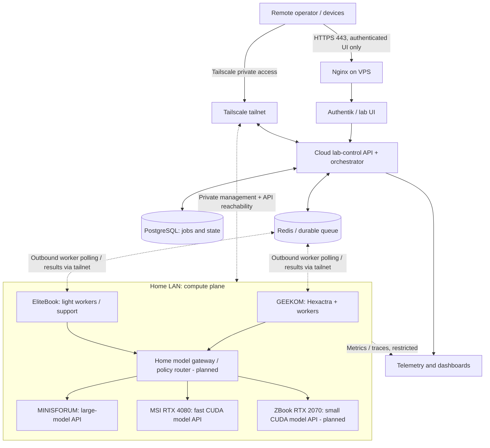
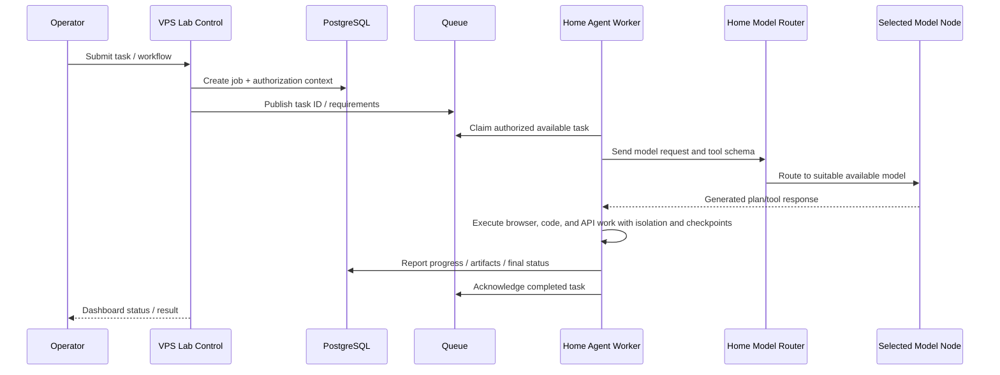

> **Imported source (archive, redacted).** Original: https://gist.github.com/marinoscar/ee3e7687ff0cce690cd66b71c130dbe4 (AI-Lab.md)  
> Imported: 2026-11-02. Lab-specific values replaced with placeholders (see `inventory.example.yaml`).  
> This file is a historical record only. The maintained instructions are in [`docs/runbooks/`](../runbooks/) and [`docs/specs/`](../specs/).

# AI Home Lab — Architecture, Inventory & Operating Blueprint

> **Document:** `AI-Home-Lab.md`  
> **Version:** 1.2 — 2026-10-24 (Mermaid diagram syntax repair; VPS specifications retained)  
> **Scope:** Home AI compute cluster, cloud VPS control plane, secure private networking, agent execution, model serving, physical equipment, operations and roadmap.  
> **Status:** Architecture and inventory reference; distinguishes deployed, owned-but-not-configured, planned, and to-be-verified items.  
> **Suggested repository location:** `marinoscar/marin-server-infra/docs/AI-Home-Lab.md` (not yet committed).

## 1. Vision and operating principles

Build a **personal distributed AI research and agent-execution lab** that combines powerful home hardware, several independent LLM inference backends, isolated browser/automation workers, and a cloud VPS serving as a secure coordination and management plane.

The lab is intended to support:

- Parallel AI agents working on independent tasks, especially **Hexactra** browser/application automation.
- Local inference with heterogeneous AMD and NVIDIA accelerators, including small fast models and larger reasoning/coding models.
- Testing model selection, intelligent routing, multi-model escalation, tool calling, latency, context windows and throughput.
- Repeatable Node.js/TypeScript, Python, Docker, Chrome, OpenCode and development-agent workloads.
- Knowledge-graph, ontology, experiential-memory and retrieval experiments, with interchangeable backend components.
- Remote access, scheduling and monitoring without exposing home-machine management endpoints to the public internet.
- Gradual growth into reliable distributed execution while **avoiding premature Kubernetes and cluster complexity**.

**Architecture principle: cloud control, home compute.** The GPU-less VPS (advertised Cloud VPS 12 plan: **12 vCPU, 48 GB RAM**) owns the public-facing control plane, authentication, workflow/job state and coordination. Home machines execute CPU/GPU-intensive jobs. Workers generally **pull** tasks rather than granting broad remote shell execution to the cloud.

**Important distinction:** Counts of RAM, GPU memory, SSD and CPU cores across machines are **aggregate resources, not a single shared computer**. A local model on one machine cannot automatically use another machine's RAM or VRAM. Distributed inference requires specific software and networking; it is not the default.

### Status legend

| Status | Meaning |
|---|---|
| **Owned — operating** | Hardware owned; stated operating characteristics are known from conversations or screenshots. |
| **Owned — configuration planned** | Hardware owned; desired Ubuntu/server configuration has not been confirmed completed. |
| **Planned purchase** | Discussed intent to buy; actual acquisition and condition not yet confirmed. |
| **Planned service** | Architectural target, not an assertion that the service exists today. |
| **Documented VPS service** | Described as deployed in the infrastructure repository's server setup document; live state not independently checked. |
| **Verify** | Requires on-machine inspection or measurement. |

---

## 2. Inventory — entire environment

### 2.1 Compute-node inventory (home + cloud)

| ID / role | Machine | CPU | Cores / threads (VPS: vCPU) | RAM | Storage | GPU / accelerator | Status |
|---|---|---|---:|---:|---|---|---|
| `ai-max-01` | **MINISFORUM MS-S1 Max** | AMD Ryzen AI Max+ 395 | **16 / 32** | **128 GB LPDDR5x unified** | **2 TB NVMe** | **AMD Radeon 8060S**, 40 CUs; integrated in unified-memory system | **Owned — operating** |
| `ai-cuda-01` | **MSI Stealth 17 Studio A13VH-053US** | Intel Core i9-13900H | **14 / 20** (6P + 8E) | **32 GB DDR5-5200** | **1 TB NVMe** | **NVIDIA RTX 4080 Laptop**, **12 GB dedicated GDDR6**, up to 105 W | **Owned — Windows 11; Ubuntu dual boot planned** |
| `agent-worker-01` | **GEEKOM A8** | AMD Ryzen 7 8745HS | **8 / 16** | **16 GB DDR5** | **1 TB NVMe** | **AMD Radeon 780M** integrated, shared RAM | **Owned**; current installed OS to verify |
| `laptop-ubuntu-01` | **HP EliteBook 840 G6** | Intel Core i7-8665U | **4 / 8** | **16 GiB** | **512 GB** (shown as 512.1 GB) | Usually **Intel UHD 620**; optional AMD GPU available for this model; actual unit **not verified** | **Owned — Ubuntu 26.04.1 LTS confirmed by screenshot** |
| `ai-cuda-02` | **HP ZBook Create G7** (#3 from seller) | Intel Core i7-10850H | **6 / 12** | **16 GB DDR4 soldered** | **512 GB NVMe** | **NVIDIA RTX 2070 Max-Q**, **8 GB dedicated GDDR6** | **Planned purchase**, quoted **$350**; inspect before paying |
| `cloud-control-01` | **Cloud VPS 12** | Virtualized host CPU (model not specified) | **12 vCPU** (not physical-core count) | **48 GB** | Advertised **400 GB SSD / 200 GB NVMe** (storage option or allocation to verify) | **No GPU** | **Existing Ubuntu VPS**; plan details supplied by owner; live allocation to verify |

**Hardware totals — home machines only:**

| Metric | Already-owned four machines | After ZBook purchase |
|---|---:|---:|
| Computers | **4** | **5** |
| Physical CPU cores | **42** | **48** |
| CPU threads | **76** | **88** |
| Aggregate installed RAM | **192 GB** | **208 GB** |
| Aggregate nominal installed SSD capacity | **~4.5 TB** | **~5.0 TB** |
| Independent primary GPU-based LLM inference nodes | **2** | **3** |
| Dedicated NVIDIA GPU VRAM, summed across independent nodes | **12 GB** | **20 GB** |

The **cloud VPS adds 12 virtual CPUs and 48 GB of RAM** for orchestration, persistent services and scheduling; it is **not included in the home-computer physical-core totals**, and vCPU count cannot be equated with dedicated physical CPU cores. Including the VPS, installed/provisioned RAM would be **240 GB across five already-owned machines** (four at home plus VPS) or **256 GB across six machines after the planned ZBook**, assuming the advertised VPS configuration matches the live allocation. Memory remains separate per node.

The **128 GB MINISFORUM memory is shared CPU/GPU memory**, not a separate 128 GB NVIDIA-like dedicated VRAM pool. The MSI and ZBook have 12 GB and 8 GB **dedicated** NVIDIA VRAM respectively. The GEEKOM's Radeon 780M is a fourth usable integrated GPU, but not a primary inference target. Do not sum the three accelerator memory types into one global model-size limit.

### 2.2 Node-specific hardware notes

#### MINISFORUM MS-S1 Max — large-memory inference anchor (`ai-max-01`)

- **CPU:** Ryzen AI Max+ 395, 16 Zen 5 cores / 32 threads.
- **GPU:** Radeon 8060S, 40 compute units; integrated AMD graphics.
- **Memory:** 128 GB LPDDR5x, high-bandwidth unified architecture; installed on board, **not a routine user-upgradeable RAM configuration**.
- **Storage:** Purchased **2 TB NVMe**; platform specifies two M.2 2280 slots, one PCIe 4.0 x4 and one x1.
- **Network:** **2 × 10 GbE RJ45** plus Wi-Fi 7.
- **User-reported software baseline:** Linux inference environment, `llama.cpp` using Vulkan, systemd service, OpenAI-compatible API/reverse proxy and Tailscale. **Qwen3.8 Flash / Flash-Next** is the current user-preferred local model; earlier testing used a 27B variant. Exact local service names, model filenames and active contexts should be confirmed from the running host.
- **Recommended primary use:** Larger quantized models, more demanding reasoning and coding, complex context windows, benchmarking AMD unified memory, fallback for challenging agent decisions.
- **Caution:** GPU model throughput and KV-cache limits depend on model size, quantization, actual GPU memory allocation and workload. The device's 128 GB is not all available to one model after OS/runtime allocations.

#### MSI Stealth 17 Studio — high-performance CUDA inference (`ai-cuda-01`)

- **Exact retail configuration:** Stealth 17 Studio **A13VH-053US**.
- **CPU:** Intel i9-13900H, **6 performance + 8 efficiency cores**, 20 threads.
- **GPU:** RTX 4080 Laptop, **12 GB GDDR6**, maximum graphics power **105 W with Dynamic Boost** for this SKU. Laptop GPU power/thermals differ from desktop RTX 4080.
- **RAM:** **32 GB (2 × 16 GB) DDR5-5200**; up to 64 GB is reported for the platform, but verify supported module combinations before upgrading.
- **Storage:** Existing **1 TB NVMe**. Retail technical listing reports a **second available M.2 PCIe 4.0 SSD slot**; visually verify before purchasing/installing another SSD.
- **Network:** **2.5 GbE** wired, Wi-Fi 6E.
- **Power:** Manufacturer configuration lists **240 W AC adapter**.
- **Current OS:** **Windows 11** (user-confirmed). **Target:** Windows + Ubuntu dual boot; **Ubuntu default** for server use, preserve Windows.
- **Recommended use:** Low-latency quantized 4B–9B class models; experiment with 12B–14B only if the model, quantization and desired KV cache actually fit in 12 GB. CUDA workloads, embeddings/rerankers, multimodal experiments and extra bot execution.
- **Dual-boot limitation:** Ubuntu and Windows are alternative boot environments, **not simultaneously active**. The Linux inference endpoint is offline whenever MSI is booted into Windows or sleeping.

#### GEEKOM A8 — primary agent execution (`agent-worker-01`)

- **CPU:** Ryzen 7 **8745HS**, 8 cores / 16 threads, Zen 4.
- **RAM:** **16 GB installed**; GEEKOM's technical support guide lists **up to 64 GB DDR5 SO-DIMM**. Recommended upgrade: **32 or 64 GB only when measurement shows memory pressure**.
- **Storage:** **1 TB NVMe**; single primary M.2 storage slot indicated in product support material.
- **GPU:** Radeon 780M integrated, shares system RAM.
- **Network:** **1 × 2.5 GbE** RJ45; Wi-Fi 6E.
- **Recommended use:** Hexactra orchestration of visible Chrome/browser workloads, Node.js/TypeScript agents, Python worker containers, testing, and optional home-side LLM API gateway.
- **Verify:** Current installed OS, RAM module layout, CPU power limits, storage and service runtime.

#### HP EliteBook 840 G6 — infrastructure and light workers (`laptop-ubuntu-01`)

- **Direct screenshot:** Ubuntu **26.04.1 LTS**, hostname **`laptop-ubuntu-01`**, Intel **i7-8665U**, **16.0 GiB RAM**, **512.1 GB** storage.
- **CPU:** 4 physical cores / 8 threads. GNOME's screenshot shows `× 8` logical processors, **not eight physical cores**.
- **RAM upgrades:** HP specification lists **2 accessible DDR4 SO-DIMM slots** with **32 GB supported maximum**.
- **GPU:** Intel UHD 620 is the normal configuration; this model also offered an optional Radeon RX 550. Run `lspci` to identify actual GPU.
- **Recommended use:** Redis/queue experimentation, lightweight worker agents, schedulers, health probes, browser sessions with modest RAM budgets, logging/testing, and fallback administrative node.
- **Avoid:** Assuming this low-power 2019 CPU is an efficient large-LLM inference host.

#### HP ZBook Create G7 — second NVIDIA inference node (`ai-cuda-02`)

- **Seller quote:** **$350**, Intel i7-10850H (verify full CPU model suffix), 16 GB RAM, 512 GB SSD, RTX 2070 **Max-Q with 8 GB**.
- **CPU:** 6 cores / 12 threads.
- **RAM:** Retail configuration documentation reports **16 GB soldered**, generally **not upgradeable**. Confirm exact machine model/board before purchase; do not plan on increasing this to 32 GB.
- **GPU:** Dedicated NVIDIA RTX 2070 Max-Q, **8 GB GDDR6**, CUDA available.
- **Recommended use:** Small 3B–8B quantized model endpoint with realistic context sizing, a second independent CUDA model, and light CPU agents.
- **Limitations:** Older GPU, 8 GB VRAM, 16 GB system RAM and laptop thermal constraints. Avoid promising high concurrent Chrome counts or unrestricted 8B context windows.
- **Purchase-time verification:** BIOS is unlocked, no enterprise management lock, stable thermals, functioning NVIDIA GPU, SSD health, battery condition, charger, no physical damage, no hidden hardware faults.

---

## 3. Cloud VPS — existing control-plane foundation

**Infrastructure source of truth:** [marinoscar/marin-server-infra — `docs/server-setup.md`](https://github.com/marinoscar/marin-server-infra/blob/main/docs/server-setup.md).

### 3.1 Existing software platform

The current repository document describes an Ubuntu VPS with the following components **already documented** (not independently live-checked):

| Component | Purpose | Documented state |
|---|---|---|
| Docker Engine + Docker Compose | Containerized applications and lifecycle management | Deployed |
| Nginx reverse proxy | Public HTTPS entry point on 80/443 | Deployed |
| Let's Encrypt / certbot | TLS certs and renewal | Deployed |
| Authentik | Authentication/SSO and potential protection for lab dashboard | Deployed at `auth.marin.cr` |
| PostgreSQL + pgAdmin | Persistent application data | Deployed; **PostgreSQL 5432 documented as publicly allowed** |
| Cockpit | VPS administration | Deployed at `admin.marin.cr` |
| CrowdSec | Host security defense | Documented |
| UFW | Default-deny firewall, explicit port allowances | Documented |
| Git/GitHub infrastructure repository | Versioned deploy/configuration runbooks | Deployed |
| Knecta web and API | Existing independent application on VPS | Documented |

**Documented publicly allowed inbound ports:** `22/tcp`, `80/tcp`, `443/tcp`, **`5432/tcp`**. Verify live firewall/cloud-provider rules before taking action. Moving PostgreSQL behind private networking is a **priority hardening improvement**, not a prerequisite to understanding this architecture.

### 3.2 Cloud VPS 12 — owner-provided plan configuration

The owner supplied a screenshot of the **Cloud VPS 12** plan on **2026-10-24**. These are **plan-advertised specifications**, not measurements taken from the running instance. The VPS has **no GPU**, by owner confirmation; all accelerated LLM inference belongs on the home-lab nodes.

| Resource | Cloud VPS 12 plan | Operating interpretation |
|---|---|---|
| Compute | **12 vCPU cores** | Virtual CPU allocation; underlying physical CPU model, contention and sustained performance are not specified. Suitable for the lab controller, scheduler, APIs, database and lightweight CPU work; do not treat as 12 dedicated physical cores. |
| Memory | **48 GB RAM** | Shared by existing VPS apps and future orchestration services. Set container and database limits to avoid starving production services. |
| Accelerator | **None — no GPU** | Do not plan CUDA, ROCm or GPU-hosted LLM inference on this VPS. Route inference over private Tailscale/LAN paths to home nodes. |
| Disk offering | **400 GB SSD / 200 GB NVMe** | Screenshot advertises both figures separated by a slash; **do not assume 600 GB combined** or two provisioned disks. Verify whether these are storage variants and which allocation/filesystem the VPS actually has. |
| Snapshots | **3 snapshots** | Advertised snapshot allowance; validate retention, restore workflow and whether they are provider-local. Snapshots are not a substitute for independent off-site encrypted backups. |
| Network | **800 Mbit/s port** | Advertised port speed, **not a measured or guaranteed throughput** to the home lab. Real Tailscale throughput depends on route, latency, relay/direct path, and home Internet uplink. |
| Traffic | **Unlimited traffic*** | Promotional wording carries an asterisk; confirm fair-use policy, exclusions and provider terms. |
| Advertised price | **$24/month for first 24 months**; **$30/month crossed-out reference** | Treat these as screenshot offer prices, **not proof of the current billing rate, renewal price, taxes or provider**. |

**Sizing conclusion:** 12 vCPUs and 48 GB of RAM provide a strong starting point for a cloud **control plane**: authenticated dashboard, API, PostgreSQL, job queue, scheduling, metrics and audit logs. They do **not** increase home GPU VRAM, and should not be counted as model-inference capacity. Existing VPS workloads (Knecta, Authentik, Nginx, Cockpit, Postgres) must be included in real resource measurements before allocating new services.

**Verify the live VPS instance** using `nproc`, `free -h`, `lsblk -o NAME,SIZE,TYPE,MOUNTPOINTS`, `df -h`, and provider billing/snapshot dashboard before setting actual service quotas. The provider name, region, actual disk layout, backup retention and renewal pricing remain unverified.

### 3.3 Operating conventions and planned services

The infrastructure runbook establishes:

- One application per folder, one Docker Compose file, under **`/opt/infra/apps/<appname>`**.
- Shared proxy configuration under **`/opt/infra/proxy/`**, Nginx host configs in `nginx/conf.d/`.
- Git `main` tracks the deployed, stable server state; keep experimental changes on branches.
- `.env`, secrets, app persistent data, certificates and backups must **never** be committed to Git.
- VPS administration is currently done as **root**, deliberately. Maintain that existing operational convention in procedural commands; for new application runtimes, prefer non-root container users and narrow privileges.
- Operator prefers `nano`, explicit shell commands, small verifiable steps and readable runbooks.

**Suggested future app folders** (none asserted deployed):

```text
/opt/infra/
  apps/
    lab-control/          # API, authenticated control dashboard
    lab-queue/            # Redis / queue broker
    lab-orchestrator/     # Scheduling and state transitions
    lab-observability/    # Metrics, traces, logs, dashboards
    lab-model-registry/   # Model/node metadata; may be part of lab-control
  proxy/
    nginx/conf.d/         # Existing + planned lab virtual hosts
  docs/
    AI-Home-Lab.md        # This reference after review/commit
```

Avoid deploying redundant PostgreSQL instances unless warranted. Use isolated databases/roles or schemas in the existing instance and grant least privilege.

---

## 4. Target end-to-end architecture



**Diagram is logical, not proof of deployment.** The VPS is a **12-vCPU/48-GB, GPU-less control-plane node**; proposed model gateway, queue, orchestration application and telemetry stack still need implementation. The cloud VPS and home LAN are distinct security and latency domains.

### 4.1 Trust and traffic boundaries

1. **Public ingress:** Browser → VPS Nginx over TLS → Authentik → authorized control/dashboard. Expose only explicitly approved UIs/APIs publicly.
2. **Private administration:** Operator and VPS access machines as authorized peers via **Tailscale**; no home-router port forwarding required.
3. **Home inference data plane:** Home agents preferentially reach model APIs over **wired LAN** (or direct tailnet connectivity if simpler) to avoid unnecessarily hairpinning inference traffic through the VPS.
4. **Cloud orchestration:** VPS tracks jobs, users, schedules, approvals and status; **workers initiate outbound communication** to receive/claim jobs and report outcomes.
5. **Sensitive traffic:** Model API keys, logs, screenshots, browser credentials, OTPs and agent artifacts require explicit access policy, encryption at rest where appropriate, retention limits and redaction.
6. **Failure boundary:** If the cloud VPS or Internet is unreachable, local model servers should remain usable on the home LAN. Cloud-dispatched jobs may pause/retry, subject to queue semantics.

### 4.2 Networking and naming plan

| Purpose | Suggested name | Network exposure |
|---|---|---|
| Cloud controller | `cloud-control-01` | Public HTTPS only for approved apps; SSH/admin via tailnet where possible |
| MINISFORUM | `ai-max-01` | Model API private to LAN/tailnet |
| MSI | `ai-cuda-01` | Model API private to LAN/tailnet |
| ZBook | `ai-cuda-02` | Model API private to LAN/tailnet; planned |
| GEEKOM | `agent-worker-01` | Worker control private; outbound to cloud queue |
| EliteBook | **`laptop-ubuntu-01`** | Keep existing hostname unless intentionally changed |

**Do not assume these hostnames or DNS records exist today**, except the EliteBook's screenshot-confirmed OS hostname. Record actual device names, reserved LAN IPs, Tailscale names and OS versions in a separate internal inventory after enrollment.

**Recommended network design:**

- Install Tailscale **on each node** (including VPS), rather than publishing the whole home subnet through a VPS gateway.
- Use **Tailscale grants** / tags to restrict which control-plane services, users and workers can reach each other. Check the tailnet's current default policies; do not assume it is already least-privilege configured.
- Restrict admin SSH (`22`) to trusted identities; model APIs (`11434` for Ollama by default, or explicitly chosen `llama.cpp` ports) to authorized clients only.
- Keep model-serving ports, Redis, GPU telemetry, Prometheus exporters and databases **off the public internet**.
- When combining Docker bridge networking and Tailscale, test routing/firewall behavior from inside containers. Binding a Docker port to `127.0.0.1` does **not** automatically make it reachable remotely over Tailscale; use a reviewed host proxy, Tailscale Serve, or deliberate private-interface routing.
- Prefer wired networking for inference hosts, especially the MSI/GEEKOM 2.5 GbE and MINISFORUM 10 GbE ports. **10 GbE benefits require compatible switch/cabling and peers**; it is not guaranteed merely by owning a 10 GbE port.
- Tailscale's direct peer-to-peer path is preferable when available, but NAT conditions may cause relay paths; use `tailscale ping` to inspect connectivity.

### 4.3 Candidate service ports (illustrative; confirm at deployment)

| Service | Typical port | Policy |
|---|---:|---|
| Nginx HTTPS on VPS | 443/tcp | Public only for approved reverse-proxied apps |
| HTTP/ACME on VPS | 80/tcp | Public for certificate challenges/redirect |
| SSH | 22/tcp | Private admin preferred; harden any necessary public access |
| Ollama API | 11434/tcp | **Private only**; default local API lacks auth |
| `llama.cpp` server | Configurable (often 8080) | **Private only** |
| PostgreSQL | 5432/tcp | Move to private/allowlisted access; never leave wide open by default |
| Redis | 6379/tcp | Private internal Docker network or tailnet, with authentication/access controls |
| Metrics exporters | Varies | Private only |

### 4.4 Public domain plan (all **proposed**, not existing)

- `lab.marin.cr`: Authentik-protected lab UI and dashboards.
- `jobs.marin.cr`: Optional authenticated orchestration API if needed by external clients; alternatively private-only.
- `ai.marin.cr`: **Not recommended as a raw public LLM endpoint.** If a public API is ever necessary, add strong authentication, authorization, quotas and logging/redaction before exposing it.

---

## 5. Local LLM serving strategy

### 5.1 Model tiers by machine

| Tier | Preferred machine | Example workloads | Constraints |
|---|---|---|---|
| **Large / capable reasoning and coding** | MINISFORUM 128 GB | Larger quantized models, lengthy context, complex code reasoning, difficult agent planning | AMD runtime compatibility, throughput and working-memory limits need actual benchmarks |
| **Fast CUDA / medium-small models** | MSI RTX 4080 12 GB | Responsive tool-calling, coding helpers, reranking/embeddings, 4B–9B quantized models | 12 GB dedicated VRAM, laptop 105 W thermal/power ceiling |
| **Light CUDA / specialist models** | ZBook RTX 2070 8 GB | 3B–8B quantized lightweight agents, classify/rerank, redundancy | 8 GB dedicated VRAM; small KV cache and concurrency headroom; 16 GB soldered system RAM |
| **CPU/light inference** | GEEKOM / EliteBook | Tiny classifiers, experiments and fallback utilities | Keep these primarily available for agents and infrastructure |

Model examples from past discussions include **Qwen3.8 Flash / Flash-Next** on the MINISFORUM and smaller quantized **Qwen 4B/8B-class** choices for NVIDIA nodes. These are **candidate or user-reported models**, not a statement that each is installed or guaranteed to fit. Always record the exact model artifact, architecture, quantization, context configuration, file hash and benchmark results.

**GPU behavior:** The GPU does bulk tensor computation while CPU cores can simultaneously perform Chrome automation, tool execution and hosting duties. CPU utilization is never zero; model loading, scheduling, tokenization and shared laptop cooling still matter. **Multiple requests to the same GPU share its VRAM and compute**, and model concurrency must be tuned.

### 5.2 Standard model contract

Expose each serving backend as a **private OpenAI-compatible API** where supported. Backends under evaluation:

- **`llama.cpp` server** (already used on MINISFORUM according to user-reported runbook): consistent GGUF behavior and fine-grained quantization/context controls.
- **Ollama** (recommended for initial MSI/ZBook smoke tests): simple model lifecycle and GPU usage verification.
- Optionally evaluate a centralized model router/gateway (e.g., LiteLLM or a small purpose-built service) **only when needed** for unified model IDs, routing, health and quotas.

Recommended logical model aliases rather than vendor/model-file names in every agent:

```yaml
models:  # Illustrative registry, not currently deployed
  fast:       { preferred_node: ai-cuda-02, fallback: ai-cuda-01 }
  balanced:   { preferred_node: ai-cuda-01, fallback: ai-max-01 }
  reasoning:  { preferred_node: ai-max-01, fallback: external-approved-provider }
  embeddings: { preferred_node: ai-cuda-01 }
```

No fallback is guaranteed to work unless the destination **actually hosts a suitable model**. External-provider fallback must require an explicit approved provider and controls for sensitive data.

**Route by capability, not only model size:** task type, latency target, function/tool calling, context requirement, modality, expected output quality, availability, GPU memory pressure and queue depth.

### 5.3 Benchmark methodology

For every installed model, capture:

- **Model identity:** repository/name, digest, quantization, model weights size, runtime version.
- **Serving context:** context length, batch settings, number of parallel requests, GPU offload and KV cache type.
- **Latency:** first-token latency, output tokens/second, full request completion time.
- **Capacity:** requests per minute at defined latency SLO, queue depth, GPU VRAM peak, CPU/RAM peak.
- **Quality:** representative Hexactra tool-call accuracy, coding fixes verified by tests, extraction correctness, regression suite pass rate.
- **Power/thermal:** wall power, peak temperatures, observed throttling after 30–60 minutes.
- **Reliability:** process restart behavior, failover behavior, dropped connections and timeout handling.

Avoid extrapolating CPU/GPU synthetic benchmark ratios into LLM throughput; actually benchmark the quantization and context workloads you care about.

---

## 6. Distributed agent and bot architecture

### 6.1 Job life cycle



This sequence is conceptual. In the implementation, worker writes and artifacts should be exposed through an authenticated control API or scoped credentials, **not unrestricted database superuser access**.

### 6.2 Suggested agent runtime design

- **VPS:** request validation, approvals, scheduling, routing policy metadata, durable job state, audit log and dashboard.
- **GEEKOM:** main browser-execution node: Hexactra worker containers/processes, local visible Chrome sessions as required, isolated profiles and bounded parallelism.
- **EliteBook:** additional low-priority agents; support functions, replay testing, log/event consumers and health checks.
- **MSI / ZBook CPUs:** opportunistic lightweight worker capacity while their NVIDIA GPUs serve models; cap CPU/RAM use to protect inference performance.
- **MINISFORUM:** prefer inference priority. Running extra CPU workers is possible but should not degrade critical model service.

### 6.3 Work queue requirements

Initial practical option: **Redis + BullMQ** if implementation is mostly Node.js/TypeScript; other queue technologies are valid if project constraints differ. Store authoritative job metadata/audit in PostgreSQL.

Support at least:

- Task IDs, ownership, priorities, budgets, retry limits and idempotency keys.
- Worker heartbeats and capability labels (`browser`, `gpu:nvidia`, `linux`, `chrome-visible`, `memory-gb`, etc.).
- Leases / timeouts to recover work after laptop reboot or network interruption.
- Human-in-the-loop checkpoints for authentication, OTP, destructive actions and uncertain outcomes.
- Bounded queues and model concurrency (prevent GPU overload).
- Per-task resource requirements and affinity (e.g., avoid running too many Chrome profiles on the 16 GB EliteBook).
- Durable event history, traces and a dead-letter/review queue for repeated failures.

**Delivery semantics:** Treat work as potentially **at-least-once**, with idempotent side effects and explicit human approval for sensitive actions. Do not assume exactly-once execution simply because a queue is used.

### 6.4 Hexactra integration

Hexactra is the browser/human-like interaction platform and an important lab use case:

- Chrome extension + SDK + CLI + MCP surface, with OpenAI-compatible model provider configuration.
- Visible, non-headless Chrome sessions when necessary; secure unattended session bootstrap.
- Remote initiation and human-in-the-loop handling for credentials/OTP.
- Browser sessions are assigned to available hosts, each with isolated Chrome profiles and explicit ownership.
- Prefer deterministic replay when reliable, with intelligent model fallback for unexpected UI behavior.
- Capture sanitized observations and execution outcomes for experiential memory, ontology/knowledge-graph experiments and continuous evaluation.
- Keep agent secrets in local secret stores or approved secret management, never in Git, logs, screenshots or model prompts beyond what is essential.

**Caution:** Multi-agent browser concurrency is often limited first by **RAM, browser processes, session isolation, website restrictions or model throughput**, not by raw CPU core count.

---

## 7. MSI Windows 11 + Ubuntu dual boot

**Goal:** Preserve Windows, add Ubuntu as a native Linux/CUDA serving environment, make Ubuntu the default boot, and run an automatically restarting model server.

**Preferred layout** (subject to physical SSD-slot verification):

| Drive | OS | Function |
|---|---|---|
| Existing 1 TB NVMe | Windows 11 | Existing Windows apps, firmware utilities, recovery |
| New 1–2 TB NVMe, if installed | Ubuntu **24.04 LTS** or validated 26.04 LTS | GPU inference, containers, Linux development |

Choose the Ubuntu release after checking the specific NVIDIA driver, Docker and runtime compatibility; **24.04 LTS is the conservative default**, while 26.04 LTS is an option once tested. Ubuntu Desktop can run the same server workloads as Ubuntu Server and remains useful for graphical driver/debugging tasks.

**Safety sequence:**

1. Create a verified Windows backup/recovery image and record the BitLocker/device-encryption recovery key if enabled.
2. Confirm second M.2 slot, appropriate SSD physical form factor, firmware state and warranty/access precautions.
3. Install Ubuntu to the intended drive using **UEFI**, carefully identifying disk names before writing partitions; avoid overwriting the Windows EFI/system partitions. Windows boot entry must remain tested.
4. Use Ubuntu-provided signed NVIDIA driver packages (`ubuntu-drivers` / Additional Drivers) and keep Secure Boot implications in mind.
5. Verify `nvidia-smi`, GPU memory, Ollama/`llama.cpp` model loading, and sustained inference thermals.
6. Set Ubuntu as default UEFI/boot-menu choice **only after both OS installations boot successfully**.
7. Configure Tailscale, firewall, OpenSSH, automatic model service startup, remote administration, and non-suspend lid behavior. Test reboot and GPU service restoration.
8. Document recovery steps for returning to Windows and for re-enabling Linux model service after a Windows session.

Example **non-destructive inspection/validation commands** on Ubuntu:

```bash
lsblk -o NAME,SIZE,MODEL,TYPE,FSTYPE,MOUNTPOINTS
lspci | grep -Ei 'VGA|3D|Display|Ethernet'
sudo ubuntu-drivers list
nvidia-smi
systemctl --failed
tailscale status
```

Never expose the default Ollama port publicly; confirm access policy before binding beyond loopback. With battery powered laptops in a rack, configure AC power policy and lid-close handling deliberately, while keeping air intakes unobstructed.

---

## 8. Physical layout: laptop rack, network, power and cooling

A **laptop rack/vertical organizer is planned**; specific make/model, dimensions and rack format have not yet been selected. The current lab will consist of **three laptops** after the ZBook purchase (MSI, EliteBook, ZBook) and **two compact desktops** (MINISFORUM, GEEKOM).

### 8.1 Proposed layout

```text
[Home office / lab area]

  Structured rack or ventilated shelving
  ├─ Wired network switch + patch cables
  ├─ MINISFORUM MS-S1 Max (clear fan intake/exhaust)
  ├─ GEEKOM A8 (free airflow, serviceable ports)
  ├─ Ventilated vertical laptop slots (not tightly stacked)
  │   ├─ MSI Stealth 17 Studio (high heat during CUDA inference)
  │   ├─ HP ZBook Create G7 (planned)
  │   └─ HP EliteBook 840 G6
  ├─ Separate secured AC-adapter management / PDU
  ├─ CyberPower UPS for selected critical loads
  └─ Router / network uplink / optional power monitoring
```

**Rack selection requirements:**

- Consider **19-inch rack shelves** if building a standard equipment rack, or a stable **open vertical laptop organizer** with separated slots. Do not assume standard rackmount chassis exist for these laptops.
- Leave generous airflow around GPU-laptop intakes/exhausts; **do not simply stack closed laptops directly on each other**.
- Test closed-lid sustained loads: thermal behavior and suspend settings vary by laptop. For the MSI, prioritize cooling over packing density.
- Secure laptops and adapters against slipping, manage cables and provide adequate strain relief for USB-C/power/Ethernet.
- Preserve easy access to power buttons, screens when needed, USB ports and emergency shutdown.
- Prefer dedicated wired Ethernet for always-on inference/worker nodes; test Wi-Fi only as fallback.
- Document each cable and outlet (`ai-cuda-01`, etc.). A low-cost power meter or managed PDU can help build reliable load data.

### 8.2 Existing power protection

- **Whole-home backup:** Generac **24 kW natural-gas generator**; the user expects an approximately **two-minute transition** before generator power is fully available.
- **Existing UPS:** **CyberPower CP1500PFCLCD**, **1500 VA / 1000 W**, pure sine wave / line-interactive. Originally selected to bridge the transition for the MINISFORUM, GEEKOM, networking equipment and two monitors.
- **Laptops:** Their internal batteries can bridge short outages **if the batteries are healthy and charged**; validate this rather than assuming infinite or guaranteed runtime.

**Critical:** A **1000 W UPS is not a guarantee of two minutes at any load**. High-power MSI/ZBook GPU load, MINISFORUM load, mini PC, displays and router **can collectively exceed** the UPS rating depending on operating conditions. Measure wall power under sustained inference and test actual transfer/runtime before placing all devices behind one unit.

**Recommended UPS priority:** Network/router + MINISFORUM + primary worker first; laptops can exploit their own batteries or a separately sized backup circuit. Avoid connecting printers, heaters and nonessential loads to battery-backed outlets. Test generator handoff and generator-output compatibility.

### 8.3 Network switch selection guidance

- **Minimum:** dependable gigabit ports for each host and management device.
- **Better:** a **2.5 GbE switch** for MSI and GEEKOM, with available 10 GbE uplinks/ports for the MINISFORUM if high-volume model transfer or storage traffic warrants it.
- Cat6 cabling is generally a sensible default for short home rack runs; validate link negotiation speeds and actual transfers.
- Do not buy expensive 10 GbE switching solely because the MINISFORUM has two 10 GbE ports. Compare actual traffic and peer capabilities first.

---

## 9. Security model and reliability guardrails

### 9.1 Highest-priority security actions

1. **Verify and remediate the VPS's documented public PostgreSQL `5432/tcp` exposure.** Determine active dependencies, close public access or narrowly allowlist, enforce TLS and database authentication; aim for tailnet/private-only database access.
2. **Protect lab dashboard with Authentik + MFA** and explicit roles; do not confuse TLS with user authentication.
3. **Configure Tailscale grants/tags**, narrowly allowing operators, control-plane service identities and worker/model roles to the ports they need.
4. **Keep LLM APIs private.** Many local serving runtimes do not require API tokens on their local default endpoints; private address and network policy matter.
5. **Never paste or commit credentials or signed/tokenized URLs.** A token-like parameter was present in an earlier shared GitHub raw URL; if it was active, revoke/rotate it. This document intentionally uses a clean canonical repository URL.
6. **Isolate jobs and browser profiles.** Agent-supplied code and web content are untrusted. Use narrow permissions, secret boundaries, network egress rules, approval checkpoints and timeouts.
7. **Review Docker port publishing.** Host UFW rules may not filter Docker-published ports as expected. Validate from an external vantage point and prefer loopback binds/private proxy architecture.
8. **Use least-privilege PostgreSQL and Redis credentials** for applications and workers; do not give general bots root-level SSH or database superuser access.

### 9.2 Availability and operational reliability

| Risk | Potential consequence | Control |
|---|---|---|
| MSI rebooted to Windows | Ubuntu GPU model disappears | Ubuntu default boot, health monitoring, fast failover to MINISFORUM |
| Laptop lid sleep / thermal throttling | Jobs fail or inference slows | Power policy, physical ventilation, telemetry and load tests |
| VPS unavailable | Cloud jobs and dashboard unavailable | Local model APIs continue on home LAN; queue retry/recovery plan |
| ISP outage | Home lab disconnected from VPS | Local execution mode for selected work; resumable job leases |
| Queue duplicate delivery | Repeated browser action or API call | Idempotency keys, task journaling, approvals for side effects |
| Single shared UPS overload | Lab powers down during transfer | Measure loads, budget under 1000 W with headroom, test transition |
| Secrets in model logs/artifacts | Credential or personal-data leak | Redaction, restricted retention, encryption and audit |
| Broad Tailscale permissions | Excessive lateral access | Grants and tags per service role; regular policy review |

### 9.3 Backups

- Back up **VPS PostgreSQL**, Docker Compose configuration, relevant service state, Authentik configuration and important logs to separate storage with periodic restore tests.
- Back up model registry metadata and agent state; model weight files are generally re-downloadable if authoritative hashes/URLs exist.
- Back up **Hexactra code, reproducible configs, browser session metadata (carefully), task audit, experiential memory and knowledge graph data** as appropriate.
- Keep database backups separate from the VPS and home disks; encrypt backups containing secrets or personal data.
- Preserve Windows recovery media and recovery keys before MSI dual-boot installation.

---

## 10. Monitoring, capacity planning and success criteria

### 10.1 Minimum operational dashboard

For each machine:

- Online/offline; last heartbeat, OS/kernel, uptime, load average.
- CPU use, RAM use, disk free/health and network link speed.
- GPU type, utilization, VRAM/unified-memory pressure, temperature, power draw where available.
- Inference service readiness, model loaded, requests in flight, queue depth, first-token latency and tokens/sec.
- Worker concurrency, browser-process count, running jobs, job success/retry/failure and reasons.
- UPS line/battery status and estimated available runtime if supported by monitoring interface.

**Options (planned, not installed by implication):** OpenTelemetry collector, Prometheus exporters / GPU exporters, Grafana dashboard, centralized structured logs. Prefer integrating with existing tool choices rather than introducing multiple overlapping stacks.

### 10.2 Initial baseline measurements

Run realistic tests, increasing concurrency gradually:

1. **One agent** and one model request, capture full latency.
2. **Three simultaneous Hexactra browser agents** on GEEKOM, record memory/CPU and browser failures.
3. **Six or more agents** distributed across GEEKOM and EliteBook (only if capacity allows), record queue latency.
4. Load a **4B-class quantized model** on the ZBook (after purchase) and a separate **8B-class model** on MSI (if the chosen quantization/context fits); confirm GPU offload.
5. Send independent requests concurrently to MSI, ZBook and MINISFORUM; compare response times and quality.
6. Test one machine reboot and controlled failure: queue lease expiry, model failover, resumed or idempotent job execution.
7. Run an extended thermal/UPS test before declaring the rack ready for continuous operation.

Avoid promises like “20 bots per laptop”; concurrency depends on website memory demands, model request rates, session isolation and observed thermals.

---

## 11. Implementation roadmap and acceptance tests

### Phase 0 — Inventory, security baseline, hardware health

**Work:** Confirm serial/model details, RAM/SSD, power adapters, actual OS, Ethernet, GPU detection, BIOS state, firmware and disk health; **validate the VPS plan against live 12-vCPU/48-GB allocation and determine whether 400-GB SSD or 200-GB NVMe storage is actually provisioned**, check snapshot/backup recovery readiness, and review live public port exposure.

**Exit test:** Verified inventory and recoverable backups; every owned device can be administered locally and has a named role.

### Phase 1 — Tailnet and private node access

**Work:** Enroll VPS and home hosts in Tailscale; document node identities; set least-privilege grants; verify SSH and private API access. No generic subnet routing, exit node or home-router port forwarding required.

**Exit test:** Authorized operator can reach each enrolled machine privately; unauthorized test identity cannot reach protected services; public scanning does not show new exposed lab ports.

### Phase 2 — Ubuntu dual boot and NVIDIA GPU nodes

**Work:** Preserve Windows, provision MSI Ubuntu on separate SSD if confirmed, install driver, model serving, service supervision and cooling/power policies; then set up ZBook if purchased.

**Exit test:** Windows and Ubuntu each boot successfully; `nvidia-smi` works; LLM model runs on GPU; server API reconnects after Ubuntu reboot; Windows boot makes unavailability visible in dashboard.

### Phase 3 — Standardized private inference and model registry

**Work:** Normalize model API contracts/aliases, private bindings, health checks, versioned registry, test suite and performance baseline.

**Exit test:** One client can call three separately hosted models by documented API aliases, with appropriate errors and observed failover; no unauthenticated public API exposure.

### Phase 4 — Cloud jobs and home worker execution

**Work:** Deploy lab control service + queue under `/opt/infra/apps/`; build Node.js/TypeScript or Python workers and explicit job ownership/leases; integrate Hexactra with a human-in-the-loop checkpoint.

**Exit test:** Submit a task over authenticated VPS UI/API; worker picks it up from home, calls a selected home LLM, completes safely, records evidence, and the dashboard displays status. Reboot one worker and verify retry/idempotency.

### Phase 5 — Observability and laptop rack

**Work:** Install ventilated organizer/shelving, labeling, network switch, cabling and measured UPS load policy; deploy metrics/logs/traces.

**Exit test:** Sustained multi-agent/multi-model run meets chosen thermal, latency, availability and power thresholds without unplanned suspend or overload.

### Phase 6 — Advanced experiments

**Work:** Capability-based model router, agent memory/knowledge graphs, vision/browser tools, task-specific specialists, evaluation harnesses, automated quality gates and (only if justified) container orchestration evolution.

**Exit test:** Demonstrable improvement in agent success rate, cost, quality or throughput compared with Phase 4 baseline, with reproducible experiment records.

---

## 12. Practical read-only discovery commands

On each Linux node, inspect and record results (commands do not change system configuration):

```bash
hostnamectl
lscpu
free -h
lsblk -o NAME,SIZE,MODEL,TYPE,FSTYPE,MOUNTPOINTS
lspci | grep -Ei 'VGA|3D|Display|Ethernet'
ip -brief address
sudo ethtool <ethernet-interface>    # replace placeholder after identifying interface
systemctl --failed
```

On NVIDIA-equipped Ubuntu nodes:

```bash
nvidia-smi
nvidia-smi --query-gpu=name,memory.total,memory.used,temperature.gpu,power.draw --format=csv
```

On hosts with Ollama installed:

```bash
ollama list
ollama ps
systemctl status ollama --no-pager
```

On Tailnet-connected nodes:

```bash
tailscale status
tailscale ip -4
tailscale ping <other-tailnet-device>  # replace placeholder
```

On existing VPS (current repo describes root operator and `nano`):

```bash
cd /opt/infra
docker compose version
docker ps
ufw status verbose
ss -tulpen
```

Do not paste the outputs of commands that reveal public IPs, access tokens, keys, complete process environment variables or other secrets into public tickets/repos.

---

## 13. Decisions, assumptions and unresolved items

### Decisions established by discussion

- **VPS is CPU-only (no GPU)** and is sized as **Cloud VPS 12: 12 vCPU, 48 GB RAM**, per owner-supplied plan screenshot; storage needs on-instance verification.

- Home inference will be heterogeneous: **MINISFORUM AMD + MSI RTX 4080 + planned ZBook RTX 2070**.
- The **GPU-less Cloud VPS 12 (12 vCPU, 48 GB RAM)** will coordinate private home compute via **Tailscale**; it will **not** serve GPU-hosted LLMs itself.
- **Windows stays on MSI**, but Ubuntu will be available as an alternate native boot OS and preferred server OS.
- **Rack/organizer for laptops is planned**, with power/thermal design required.
- Initial implementation should favor **Docker Compose**, simple services, explicit debugging and phased testing rather than jumping straight to Kubernetes.
- Maintain the existing infrastructure repo's Git-first, one-app/one-folder and secrets-exclusion conventions.

### Items still to verify or decide

| Item | Why it matters |
|---|---|
| **ZBook purchase completion and actual unit specs** | Inventory must not label a proposed acquisition as owned; GPU, SSD health and soldered RAM should be verified. |
| **GEEKOM current OS and network settings** | Determines install plan and worker provisioning. |
| **MSI free M.2 slot and Ubuntu SSD choice** | Safe dual boot without disturbing Windows. |
| **MSI Secure Boot, device encryption and BIOS options** | Driver signing, recovery and default Linux boot behavior. |
| **EliteBook actual GPU** | Optional RX 550 variants exist; screenshot did not show GPU. |
| **Live VPS allocations, provider, region and snapshot/backup terms** | Advertised plan shows **12 vCPU / 48 GB RAM / 400 GB SSD or 200 GB NVMe offering / 3 snapshots / 800 Mbit/s**, but actual vCPU contention, disk layout, retention, region and renewal terms need verification. |
| **Live PostgreSQL exposure and all external dependencies** | High-priority hardening decision. |
| **Tailscale enrolled nodes and grants** | Private connectivity and least-privilege authorization are proposed, not yet confirmed. |
| **Which model and quantization runs on each GPU** | VRAM fit, quality, latency and concurrency cannot be determined from GPU name alone. |
| **Laptop rack model and actual power/cooling readings** | Continuous-operation safety and UPS sizing. |
| **Which service is authoritative for workflows and agent memory** | Avoid duplicated state across cloud Postgres and home databases. |
| **Hostname, IP and private DNS convention** | Practical scripts, dashboards and model-routing configuration. |

---

## 14. Reference links (clean URLs; no credentials)

### Existing infrastructure

- [VPS setup/runbook — `marinoscar/marin-server-infra`](https://github.com/marinoscar/marin-server-infra/blob/main/docs/server-setup.md)
- [Tailscale access control](https://tailscale.com/docs/features/access-control)
- [Tailscale grants syntax](https://tailscale.com/docs/reference/syntax/grants)
- [Tailscale SSH](https://tailscale.com/docs/features/tailscale-ssh)
- [Ubuntu NVIDIA driver setup](https://ubuntu.com/desktop/docs/en/latest/how-to/graphics/install-nvidia-drivers/)

### Hardware specifications

- [MINISFORUM MS-S1 Max official product and technical specifications](https://store.minisforum.com/products/minisforum-ms-s1-max-mini-pc)
- [MSI Stealth 17 Studio A13VH-053US official configuration PDF](https://storage-asset.msi.com/excelSku/us/nb/Stealth%2017Studio%20A13VH-053US.pdf)
- [MSI SKU storage/port details from retailer](https://www.bhphotovideo.com/c/product/1757220-REG/msi_stealth_17studio_a13vh_053us_17_3_stealth_17_studio.html)
- [GEEKOM A8 manufacturer specification](https://help.geekompc.com/hc/en-us/articles/11051704273039-A8-Specifications)
- [HP EliteBook 840 G6 specs (HP specification PDF mirrored by retailer)](https://www.bhphotovideo.com/lit_files/558660.pdf)
- [ZBook Create G7 i7-10850H/RTX 2070 SKU specification](https://www.zones.com/site/product/index.html?id=301303026NEW&page_name=product_tech_spec)
- [CyberPower CP1500PFCLCD official UPS specifications](https://www.cyberpowersystems.com/product/ups/pfc-sinewave/cp1500pfclcd/)

### Provenance and accuracy notes

- Hardware **ownership, on-device EliteBook screenshot, prior Linux runbook, quoted ZBook price and intended lab design** come from the lab owner in discussion.
- CPU/GPU/port/platform details are anchored to manufacturer and retail specification sources where available, but a product family's options can differ from one physical serial-number configuration.
- The VPS services and firewall posture come from its repository runbook, **not from a live security audit**. VPS 12 plan pricing/specifications come from the owner-supplied **2026-10-24 plan screenshot**, not runtime measurements or a verified invoice.
- Runtime assignments and planned services are explicit **recommendations**, not statements of deployment.
- Recheck this document after acquisition, Ubuntu installation, Tailscale setup, material hardware upgrades and every significant architecture change.

---

## 15. Success definition

The lab is operating as intended when an authorized operator can submit an AI task through the cloud VPS; the task is queued durably; a healthy home worker claims it; the worker invokes the appropriate privately hosted local LLM; browser/tools run in an isolated, observable and recoverable context; sensitive actions are approved; the result is recorded and visible remotely; and a failed machine or network interruption results in graceful failure or controlled retry, **without exposing home LLM or management ports to the open internet**.

**Bottom line:** The home lab provides multiple independent CPUs, high-memory AMD inference, two distinct NVIDIA GPU inference tiers after the planned ZBook acquisition, dedicated agent workers, and a cloud orchestration/control plane. The next gain comes primarily from **reliability, routing, isolation and measurement**—not simply adding more hardware.

